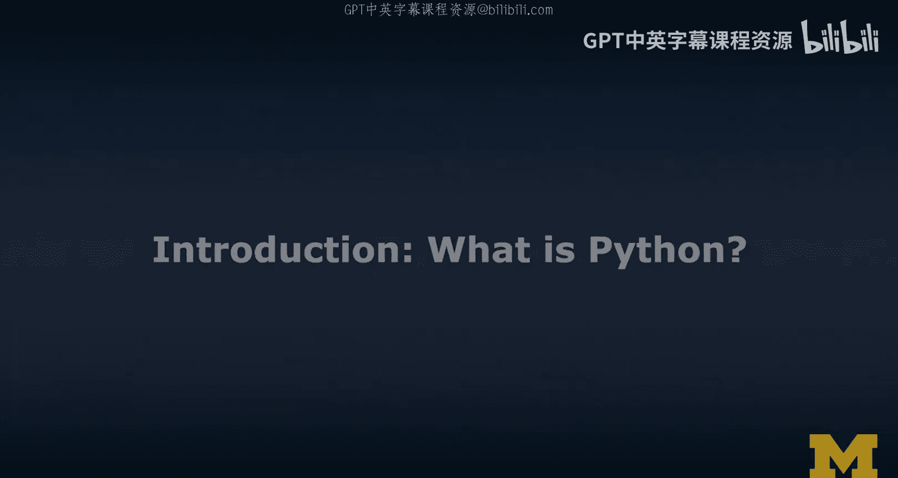
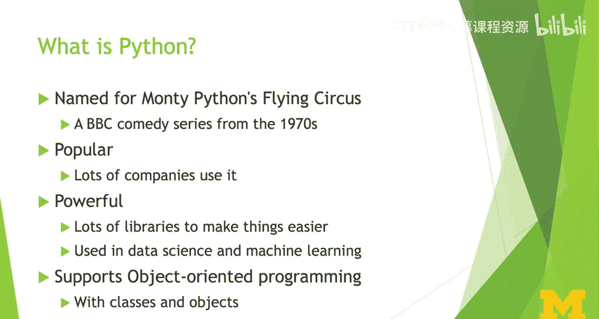
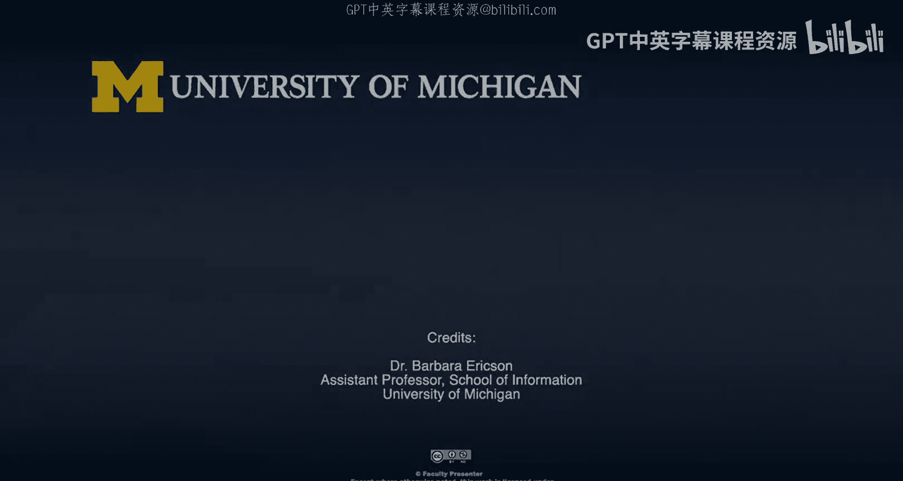

# 密歇根大学《创造性编程（创意、面向对象、debug、QA）｜Creative Coding： Hands-On Python》中英字幕 p50 2_Python是什么.zh_en -BV1ef421S7Bc_p50-

Welcome， everybody。 I'm Barbar Erickson。 I'm an assistant professor in the School of Information。

 and I'm excited to take through on this journey to learn Python。 But what is Python anyway。

 Is it a giant snake。 No， Python is named for Monty Python's Flying Circus。

 which was a BBC Comedy series from the 1970s。 If you haven't seen it， check it out。😊。

It's a very popular programming language， and lots of companies are using it。

 And partially it's popular because it's very powerful。

 There's lots of libraries to make things easier， and it's used in data science and machine learning。

 It's also a little easier to learn than a lot of other textual languages。

 It also supports object orient programming， which is the most common way that people develop programs these days。

 which means it has support for classes or classifications of things and objects that actually do the work at a program。

 So let's get started。😊。

