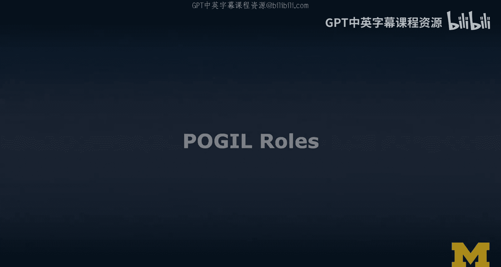
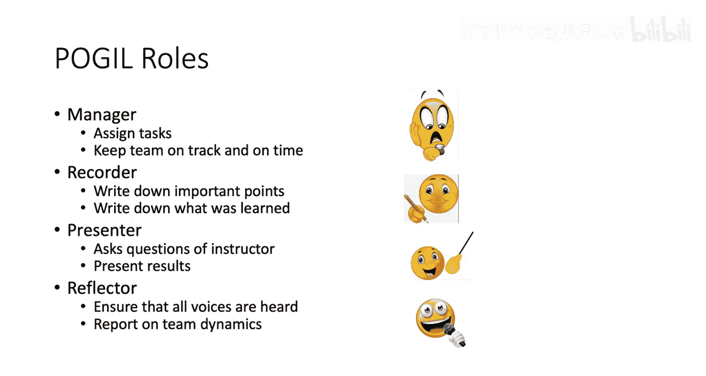
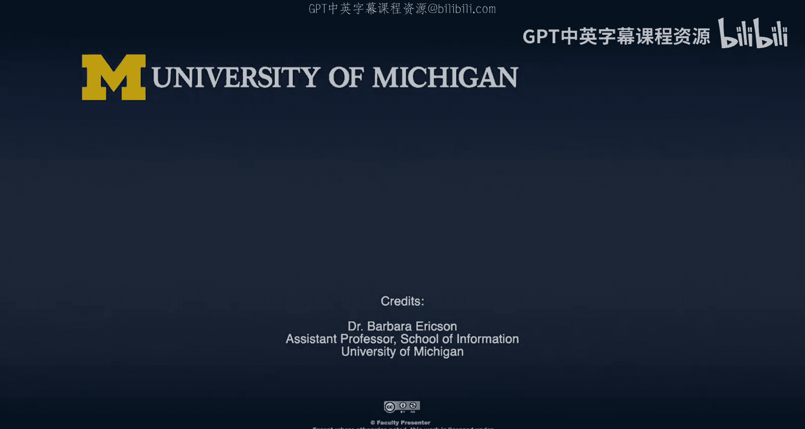

# 密歇根大学《创造性编程（创意、面向对象、debug、QA）｜Creative Coding： Hands-On Python》中英字幕 p52 4_POGIL角色解析.zh_en -BV1ef421S7Bc_p52-

So one of the things I'd like you to do when you work in groups is do Pogel activities。

 Pogel stands for process oriented guided inquiry learning。 And in Pogel。

 what happens is you work in groups， but each member of the group has a defined role。

 So what are the roles for Pogel。 Well， there are four roles， typically。

 one is a manager who assign tasks to the people in the group and helps keep the task the whole team on track and on time。

 So make sure that your're solving things if you get stuck on something may encourage you to move on。

A recorder who writes down the important points or writes down what was learned。

 a presenter who asks questions of the instructor if some things are not clear in the instructions。

 also presents the results， a reflector who makes sure that all the voices are being heard so that not only one person in the group is contributing and also can report back on team dynamics。

 how well is the team doing are they working well together what things could be improved so that's the four different roles in a po exercise。

