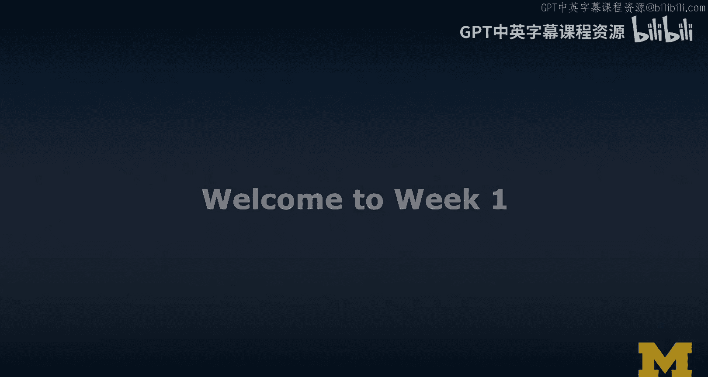
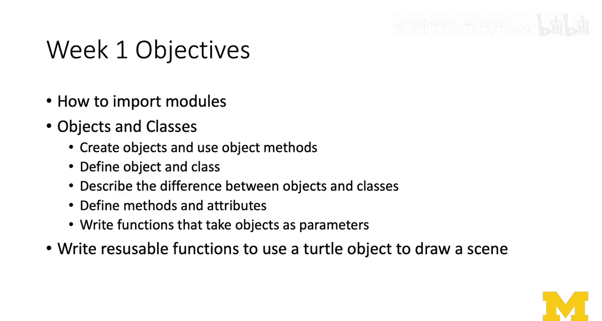
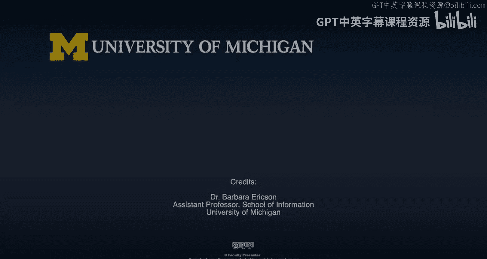

# 密歇根大学《创造性编程（创意、面向对象、debug、QA）｜Creative Coding： Hands-On Python》中英字幕 p55 7_欢迎进入第一周.zh_en -BV1ef421S7Bc_p55-

So welcome to week1。 What are we going to work on this week We're going to learn how to import modules。

 The Python language is fairly small， but there's a whole bunch of modules or libraries that you can import to use So it's one of the things you're going to learn。

 we're going to start learning about objects and classes and this is a very big idea in computing that we can organize our code into objects and classes so we're going to learn how to create objects and use object methods how to define the objects and a class De the difference between objects and classes。

 define methods and attributes or properties or behaviors of objects and you're going to write functions that take objects as parameters and then at the end of the week you're going to use write reusable functions to draw a scene with a turtle object I hope you have a great time。

