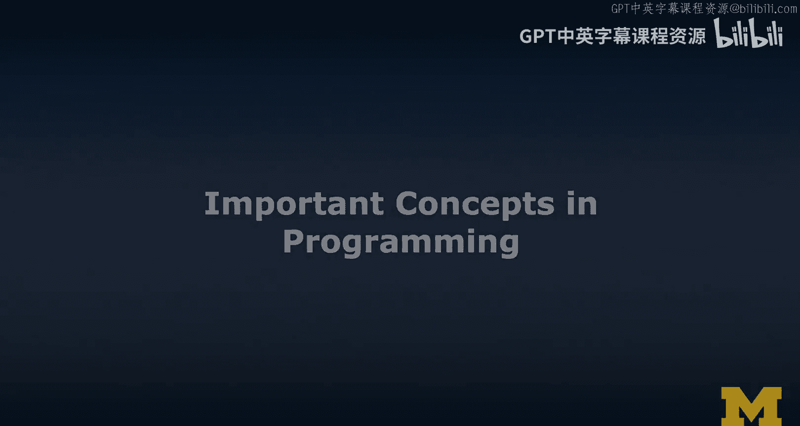
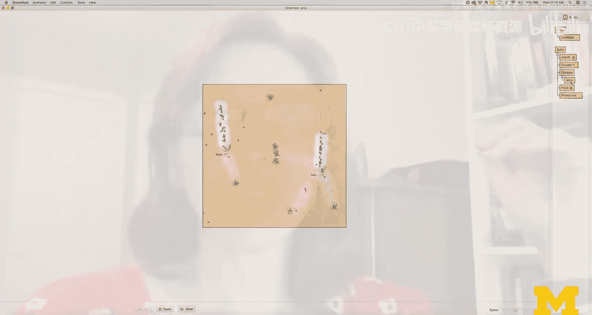
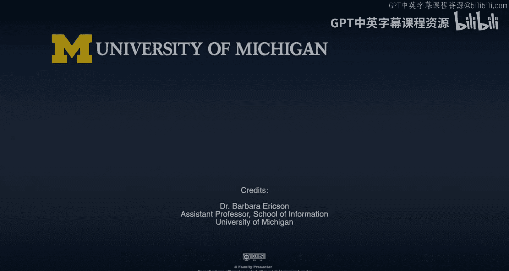
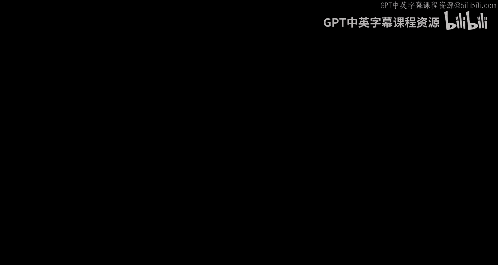

# 密歇根大学《创造性编程（创意、面向对象、debug、QA）｜Creative Coding： Hands-On Python》中英字幕 p56 8_编程核心概念解析.zh_en -BV1ef421S7Bc_p56-

One of the powerful ideas in programming is object oriented programming and this is the notion that you can write programs where you define classes or classifications of things and then you can create objects from those classes and then the objects do the work in the program let's take a look at this example if I run this。

 this is a scenario where I have ant hills and little red ants are coming out of the ant hills and they're wondering around rather randomly looking for food when they find food。

 they drop pheromones and then head back to the ant hill and other ants can follow that This is a good example of multiple you have classes of ant of world and actors。

 you have an ant hill， you have a calendar， you have a creature you have an ant and so this is an object orientd program it's a program that's broken into classes and then we create objects of those classes to actually do the work in the program。

