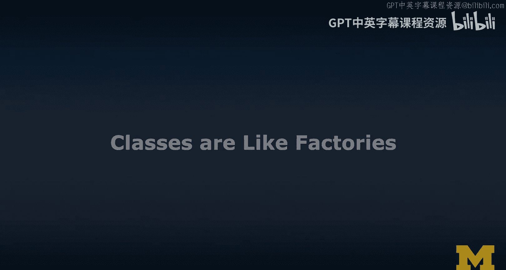
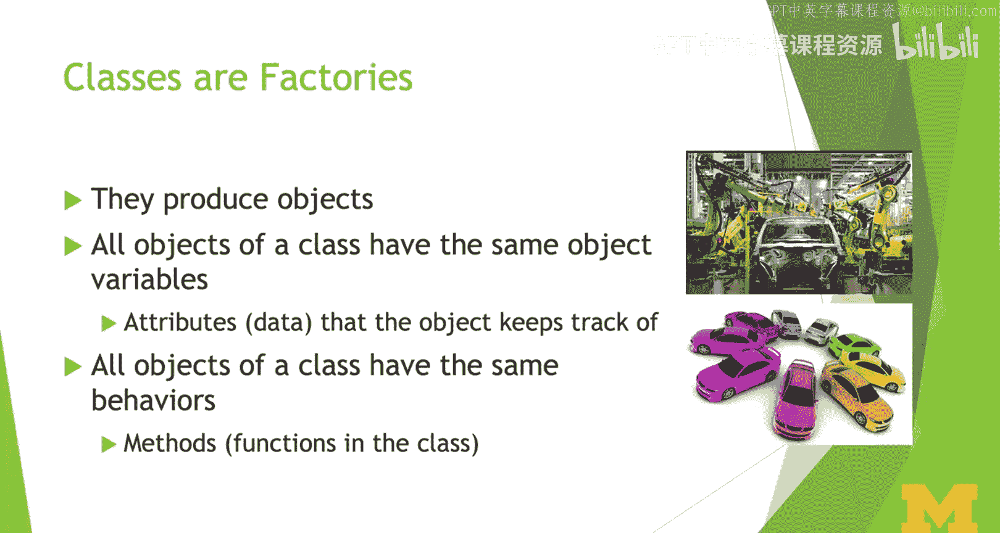
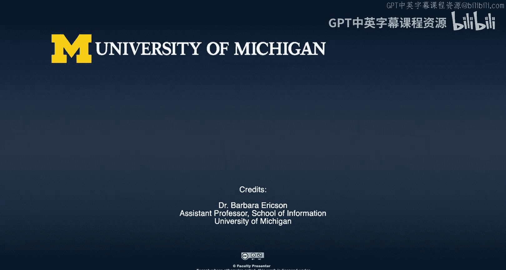

# 密歇根大学《创造性编程（创意、面向对象、debug、QA）｜Creative Coding： Hands-On Python》中英字幕 p57 9_类如同工厂.zh_en -BV1ef421S7Bc_p57-

You can think of a class as like a factory so you can create with a factory。

 you can create many objects of the same car， but they have different attributes。

 They have different color。 They might have other options on them。 So when you're ordering your car。

 you say what kind of car you want， what the color。

 what are the different attributes that you have for it。 And then when you get your car。

 you expect it can do certain things right So youd be upset。

 if you got a car and it cant go forward or backward or turn left or turn right。

 these are all things， behaviors that we expect cars be able to do。 So when you define a class。

 you define what are the attributes or data that we need to know about this object。

 And what are the things that can do or what are the behaviors。

