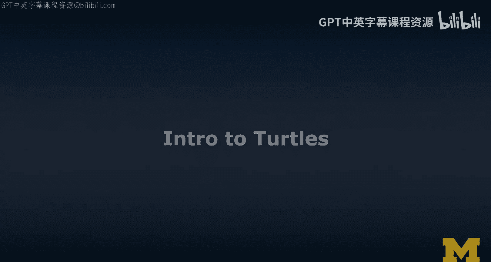
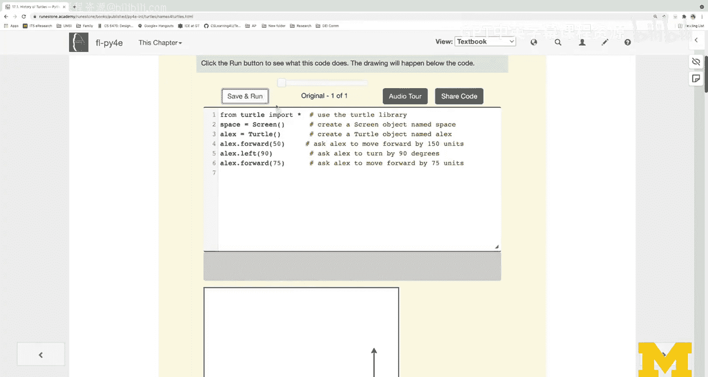
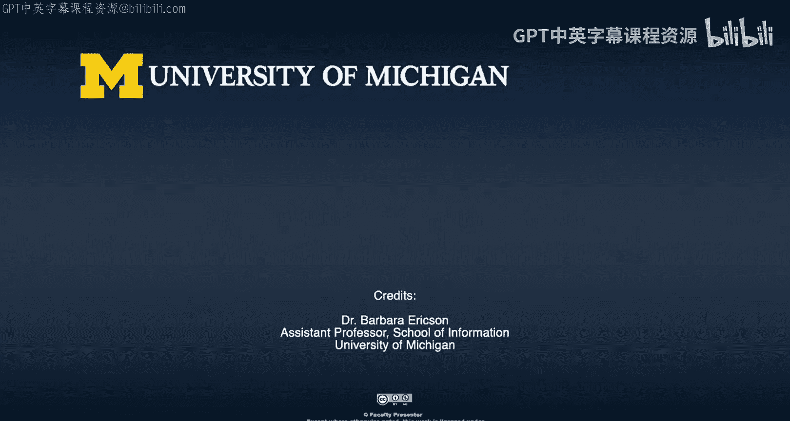

# 密歇根大学《创造性编程（创意、面向对象、debug、QA）｜Creative Coding： Hands-On Python》中英字幕 p58 10_Turtle绘图入门.zh_en -BV1ef421S7Bc_p58-

So I'm going to introduce you to objects and classes using a turtle and a turtle has a long history in computing education。

 so it dates back to the 1960s when Seymour Papperty was a professor at MIT and his team created the programming language logo and they used a robotic turtle with a pen in the middle of it that as you controlled the turtle you told to go forward。

 turn left and right would draw， And so they thought this was a great idea for using the computer to solve problems because you could use your own body knowledge about how your body works。

 how do I go forward turn left and right to solve problems with the turtle。

 So Pappert called this an object to think with and it supported in many languages now。

 including Python。 So let's take a look at how that works。

So here's some code in Python and if I run this code， I see the Turtle move and as it moves it draws。

 so I see that I've created I've imported the Turtle library。

 so Python is a small language but you can add functionality by importing libraries or modules。

I can create a space and name it。 So I create a screen object。

 name it space as a place for the turtle to draw on。 I create a turtle object。 And I call it Alex。

 And then I ask Alex using dot notation。 Alex dot， go forward。1 50 units or pixels on a screen。

 Alex turn left 90 degrees。 and then Alex go forward 75。 And that's what I see it。 do。

 I'll run one more time， goes forward， turns left 90 degrees and goes forward 75。

 I can change this code and see what happens if I do that。 So I see if I only go forward 50。

 It turns much sooner。 So that's an introduction to turtles in Python。😊。

