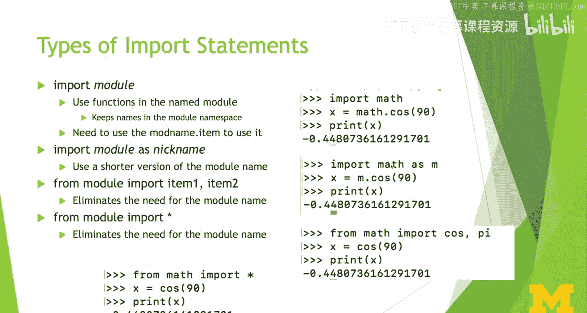
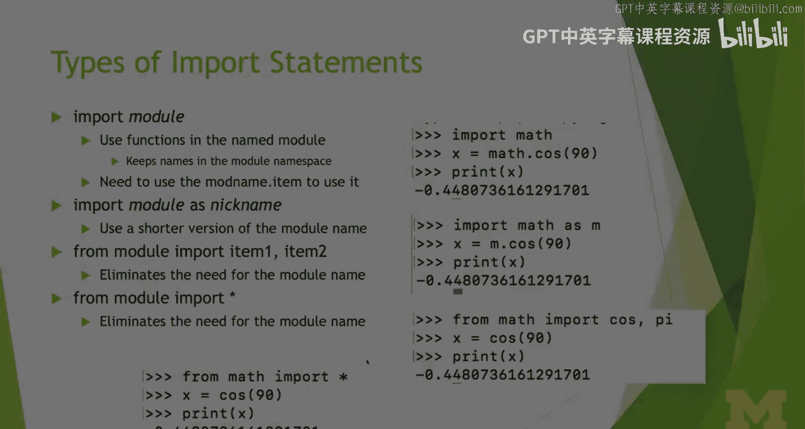

# 密歇根大学《创造性编程（创意、面向对象、debug、QA）｜Creative Coding： Hands-On Python》中英字幕 p59 11_模块导入方法.zh_en -BV1ef421S7Bc_p59-

So we're importing the tuurtle module which lets us use the commands that are found in the tuurtle class and associate with the tutle class like screen。

 So let's look a little bit more deeply at import。 there's different ways you can import in Python so you can just import a module name and what that does is let you use functions in the name module and keeps names the module name space what that means is you have to use the module name do item name if you want to use it for example here if we import math we have to say math cosine if you want to get the cosine of something so you have to put the module name dot and then whatever it is your function name is you can also import module as and use a nickname because sometimes use package names could be kind of long so I could import math is M and then I can just use M dot cosine M。

co。I can also say particularly what I want to import from the module so I can list things separated by comma so I can say from math import cosine comma pi and then I can just use those names。

 I don't have to use them the module name in front of it and what we've been doing for the turtle library using from the library。

 import star meaning import all the names and that way you don't actually have to use the module name in front Now it's recommended that you use the module name that you do this approach or this approach。

 import the module name or import the module name as some nickname because it makes sure that your name spaces are unique because you could have the same name and different modules and then that gets confusing but for just starting with the turtles。

 we went ahead and just imported everything in that library so you could just use it without the module name。

