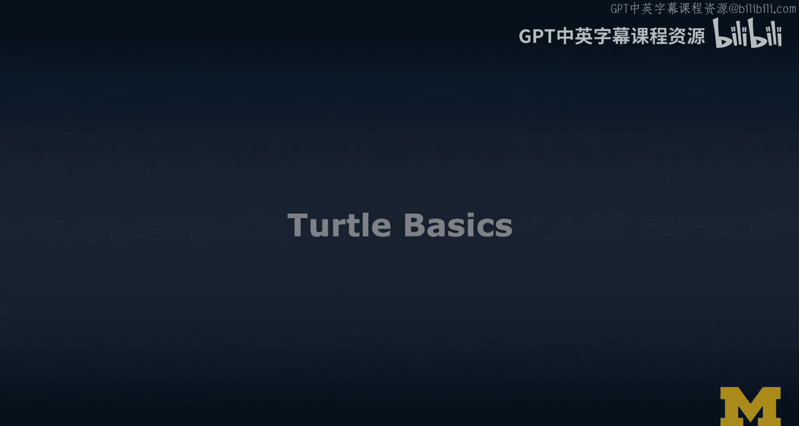
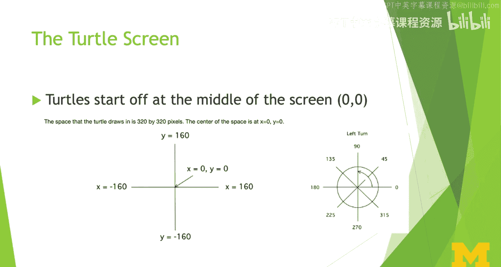

# 密歇根大学《创造性编程（创意、面向对象、debug、QA）｜Creative Coding： Hands-On Python》中英字幕 p60 12_Turtle基础操作.zh_en -BV1ef421S7Bc_p60-

So let's go over the basics of working with a turtle in Python again。

 So first thing you do is import the turtle library。 That's the code that defines the turtle class。

 You create a screen or a space for the turtle to draw。 you create a name of turtle。

 So it starts in the middle of the screen facing east。 So toward the right hand side of the screen。

 Then you ask the turtle， do things using dot notation。 So like Alex do forward， Alex do left。

 Alex step forward。The turtle screen is from negative 160 on x to the left to positive 160 on the right and negative 160 Y on the bottom to positive 160 on the top。

 And what I mean by a left turn or right turn is every turtle knows which direction it's currently facing。

 normally start off facing east。 And so if you ask it for a left turn of 90， it'll go that way。

 If you ask it for right turn of 90， it'll go that way。

 So remember that every turtle is based on which direction is it currently facing。

 Every move is based on which direction is it currently facing。

