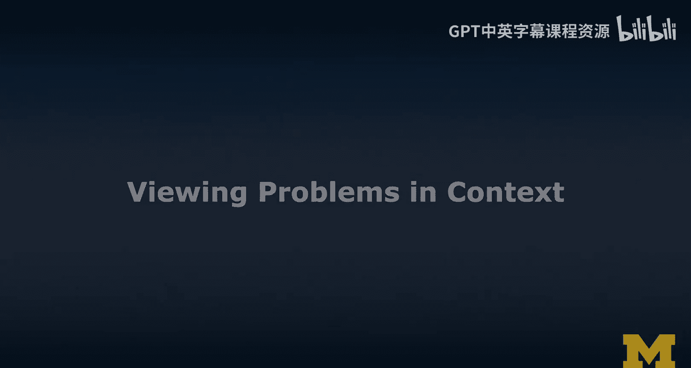
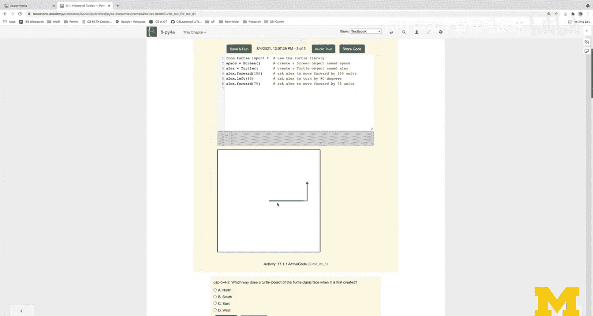
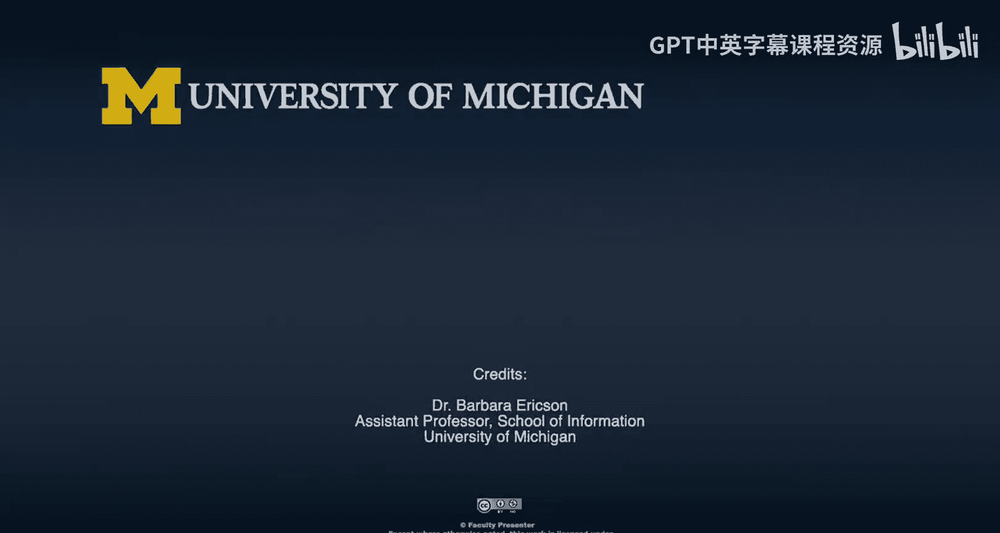

# 密歇根大学《创造性编程（创意、面向对象、debug、QA）｜Creative Coding： Hands-On Python》中英字幕 p61 13_上下文问题查看.zh_en -BV1ef421S7Bc_p61-

So let's look at how I want you to work in groups on this particular assignment。

 And one of the things you'll notice is that some of the questions may not make a lot of sense if you just look at them where they are at in the assignment what you might want to do is click on this question and context and that'll take you to the question in the context of the page that it's from。

 So， for example， here， if you want to answer the question which wait is a turtle object face when it's first created。

 you might first want to run the code above it to get an idea of what happens when I first create a turtle until it to go forward。

 So remember to click on the question and context， if you're having trouble answering the question。

