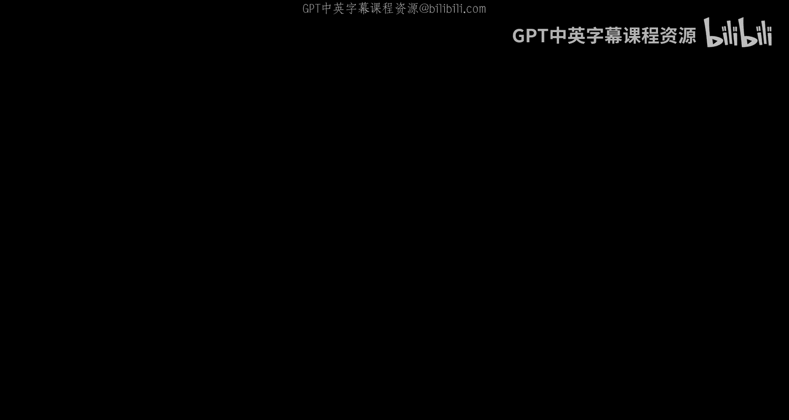
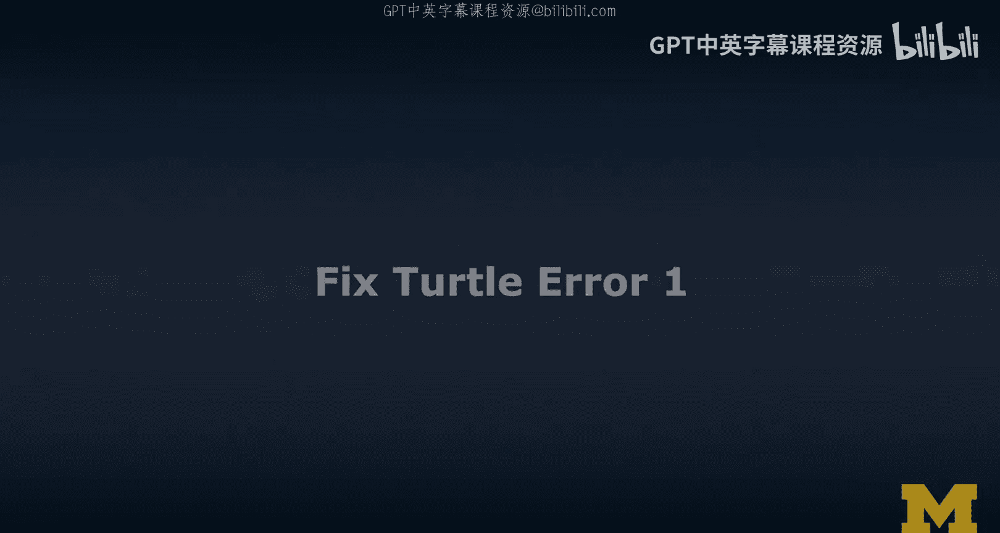
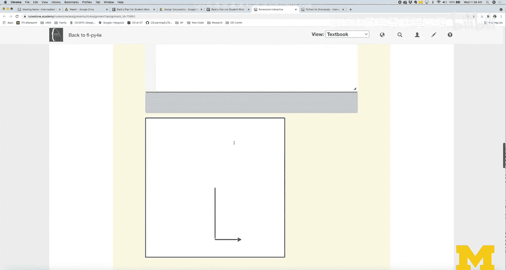
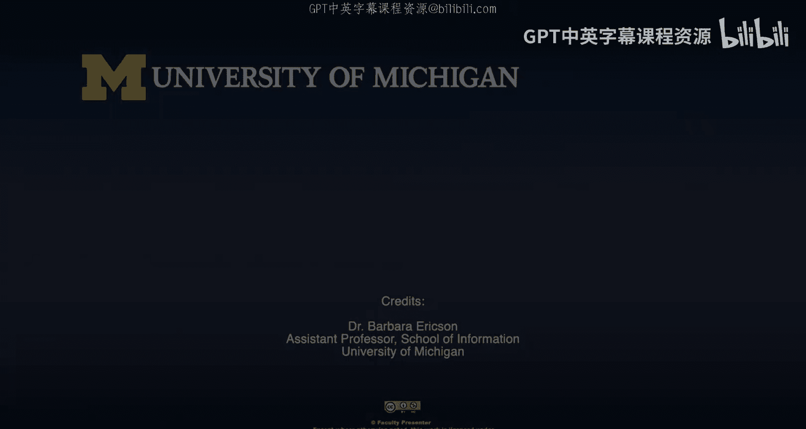
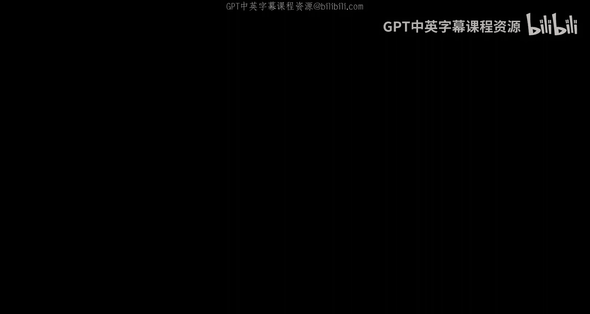

# 密歇根大学《创造性编程（创意、面向对象、debug、QA）｜Creative Coding： Hands-On Python》中英字幕 p62 14_修复Turtle错误1.zh_en -BV1ef421S7Bc_p62-

Let's take a look at how to fix some code involving turtles。

 So here's some code that gives us errors when we run it。

We first see that it says named screen is not defined in line too。

The problem is remember that classes start with an uppercase letter by convention。

 so that shows that they're an important thing， they're a category， not just a name of something。

 it is sort of opposite of what we do in English right that we wouldn't categorize。

 we wouldn't capitalize tuurtle as a type， but we would capitalize the name Alicia。

 but we do the opposite in program， we capitalize the class names。

 we don't capitalize the individual object names。So we fix that screen。

And then we see we're missing one argument on line 4。

 So whenever you see that and you don't see anything wrong with line 4。

 le do right 90 looks like a correct thing。 Look at the line above it。

 And if you may notice that we're missing parentheses there。 So that's an important tint。

 So now we have it run。 is compiling。 The code is compiling， but it's not doing what we expect。

 right， So it's supposed to turn right 90， go forward， turn left 90。 So there's something wrong here。

 So we can see that the forward is missing the 150。 So we can fix that。

We can also scroll below the picture to see where it's complaining。

 And that's where it's complaining about。 There's no forward on line 7。

 So there's a capital F forward here。 we can change that to lowercase。

 So only the class names are uppercase and a couple of the keywords like none truee and false or uppercase and Python。

 everything else is lowercase。 So if we try to run that now。

Now we see it do what it's supposed to be doing。 It's supposed to turn right 90。

  normally starts off east。 It'll go 90。 So it'll face south， Go forward to 150。

 turn left 90 and go forward 75， which draws like a large capital L。 Let's height and fix that one。

