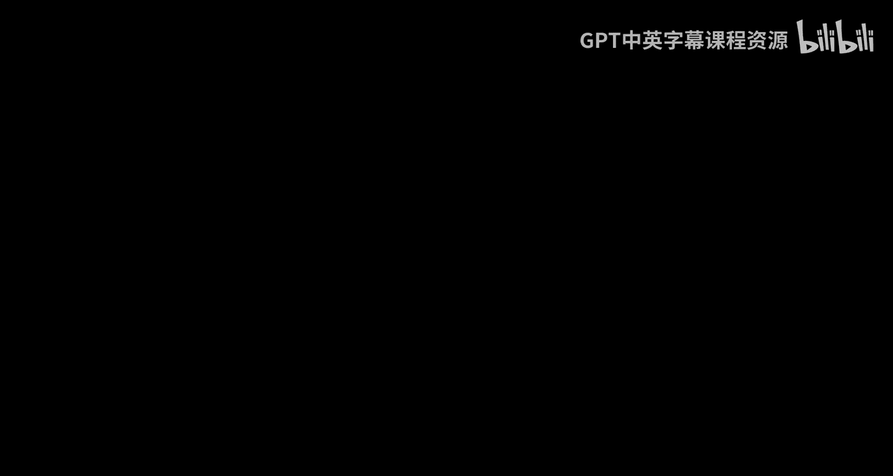
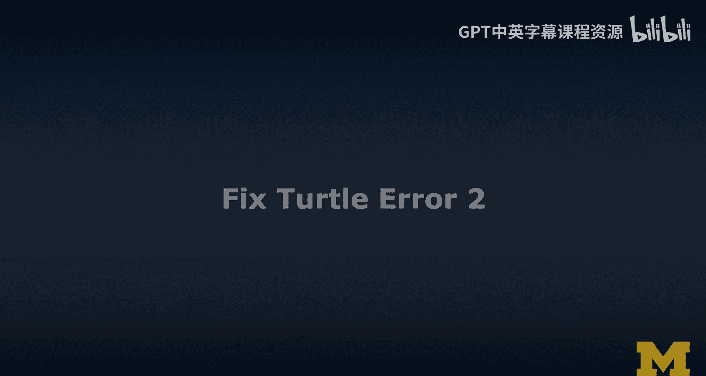
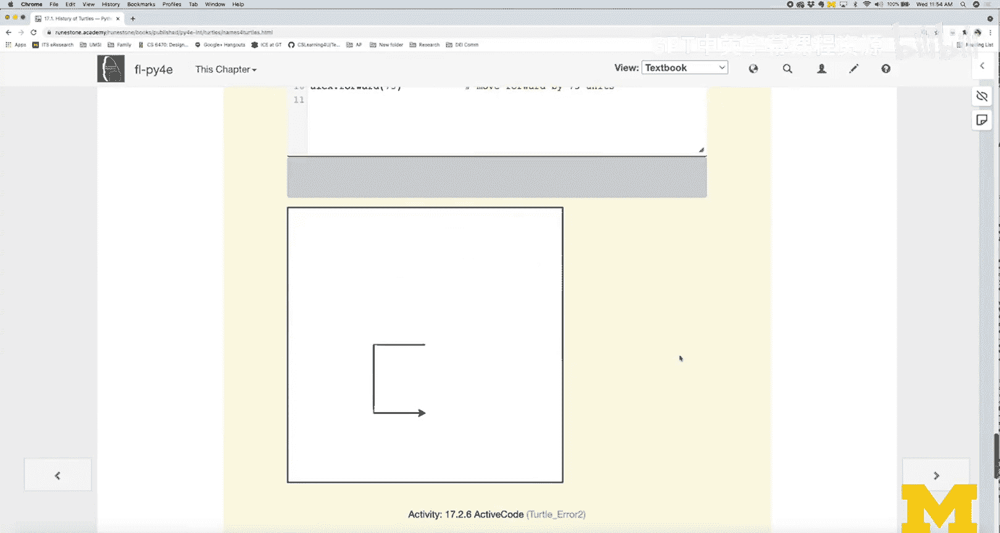
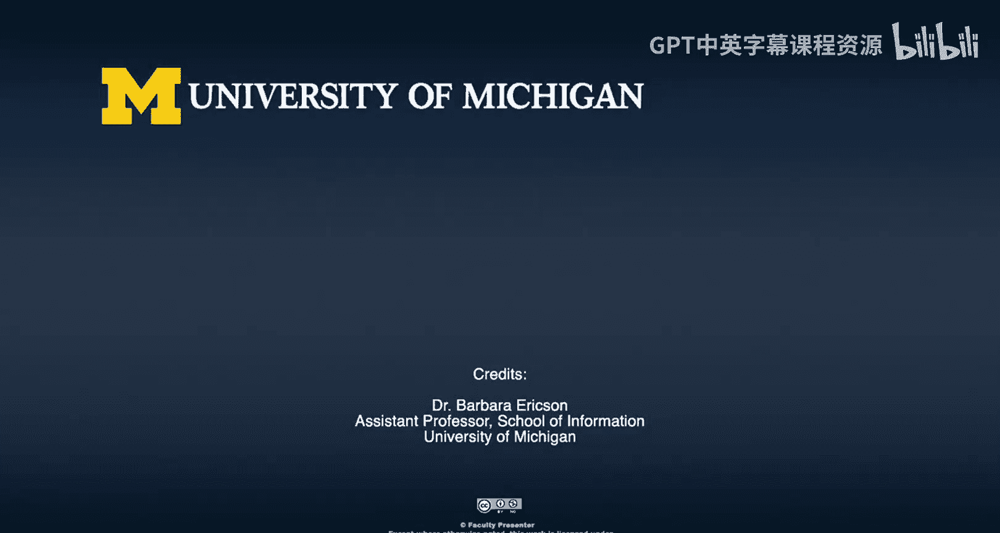

# 密歇根大学《创造性编程（创意、面向对象、debug、QA）｜Creative Coding： Hands-On Python》中英字幕 p63 15_修复Turtle错误2.zh_en -BV1ef421S7Bc_p63-

So let's take a look at how to solve this turtle problem。 We first try to save and run it。

 And we see we have bad input on line 2， line 2 here。 the problem is this capital I import。

 All Python keywords should be lower case， other than none， true or false。 So remember that。

If I run that now， I see it complaining that's missing one required argument angle on line 5。

 But line 5 has the angle。 So whenever we see an error on line number and there's nothing wrong with that line。

 look above it。 So I see that we're missing on line 4， the parentheses。 If I run that。

 I see it starts now to work。 but I still get an error。 It doesn't know what turn means on line 7。

 Turn isn't a keyword for the turtle。 What we use left。 If we want to turn left。So let's try that。

G it starts and then it doesn't quite finish because， oh， the last forward。

 we didn't tell it how much to go forward and we wanted 75。 So now if we do that， we see it finish。

