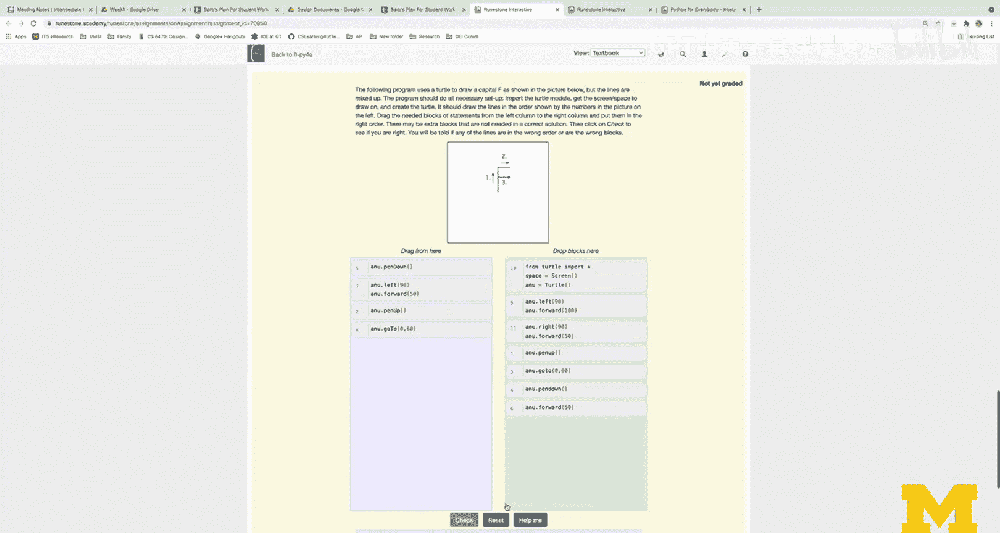

# 密歇根大学《创造性编程（创意、面向对象、debug、QA）｜Creative Coding： Hands-On Python》中英字幕 p64 16_解决绘制F问题.zh_en -BV1ef421S7Bc_p64-

So let's go over how to solve one of these mix of code problems。So first thing we want to do。

 of course， is import the turtle library and create the space and create our turtle。 name it。

 So we have a new as our turtle。 And then turtles normally start off facing east。

 We want it to first go north。 So that would be a left turn of 90。

 So I see a couple of left turn 90s。 and they go forward a different amount。 Now。

 this side is going to be the long side。 So let's try the hundred0 amount。

 Then we're going to be facing north。 We want to turn that way。 So that be it right turn of 90。

 And we go forward， say 50。Now， what do we want to do。 Well， now we want to pick up the pen。

 pick up our， pick up our turtle and go to a particular spot。 So remember the center is 0 in x。

 And so we're going back to the center in x。 but changing y。 So let's go to 0，60。

And then let's put the， we want to pick up the pen before we move there。

 and then we want to put it down after we move there。 That's always the thing to remember。

And then we'll go forward 50。So let's check that。 we see pen up， I put uppercase in there。

 it actually in Python it's all in the turtle library， it's all lowercase。 So pen up no uppercase。

 And so now that's correct。 So that's one way。 well， that is the way to solve this problem。

 though there of course there's multiple ways that you could actually write the code。

