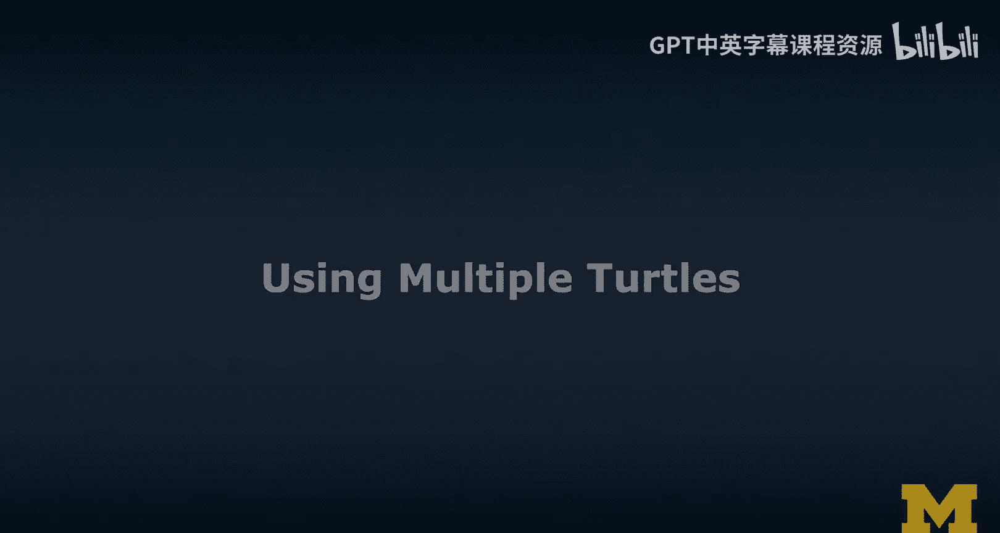
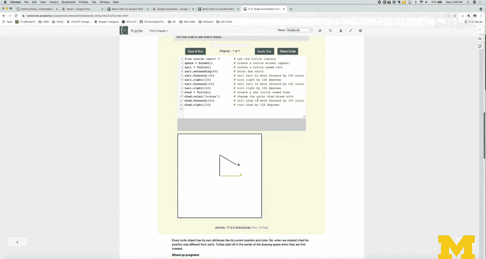

# 密歇根大学《创造性编程（创意、面向对象、debug、QA）｜Creative Coding： Hands-On Python》中英字幕 p65 17_多Turtle协同.zh_en -BV1ef421S7Bc_p65-

When you're creating objects from classes， you can create as many objects as you need and every object will have its own data that it keeps track of or its attributes and will have the same behavior。

 so the ability same ability so all turtles know how to go forward， turn left turn right。

 so let's look at that in more depth。So with the turtle class。

 you can create as many turtles as you want， every turtle as you create it gets created in the center facing east。

 and it keeps track of its own data， it knows what color it is it what its heading is。

 and know what its position is。They can all do the same actions。 They all know how to go forward。

 turn left， turn right， pick up the pen， put down the pen。

 and every turtle starts off in that center of the window facing east。 So facing to the east。

 the default color is black。 So let's see what that looks like。 So in this example。

 we see the same turtle Zri gets created and is asked to do。These things。 So set there heading to 90。

 So instead of facing east face north and then go forward 100 and then turn right 120 and then go forward 100 and then turn right 120。

 and then go forward 100 and then turn right 120 to face back the original direction。

 But if I create two different turtles。 If I have Zari and Chad， you'll see what happens then。

 So Zri starts off going forward and turning。 But when I create Chad Chadgrit's created in the center again。

 heading east。 So it does a different thing。

So watch out when you're using multiple turtles， remember that every turtle has its own heading and its own position。

