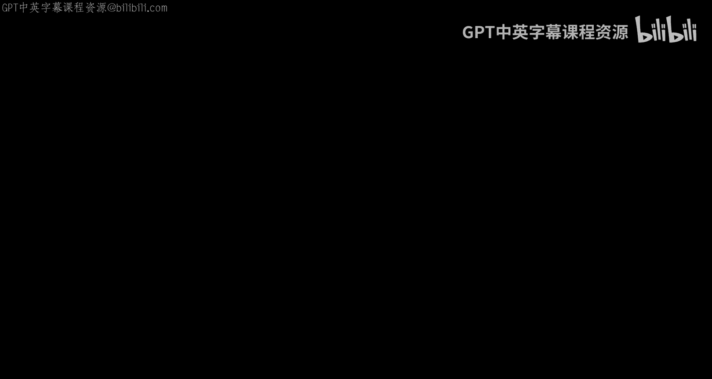
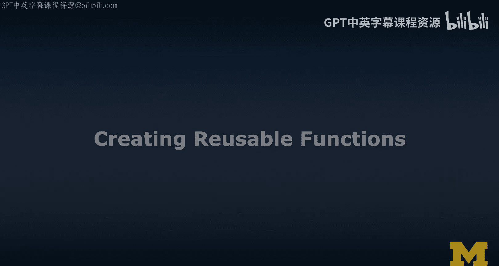
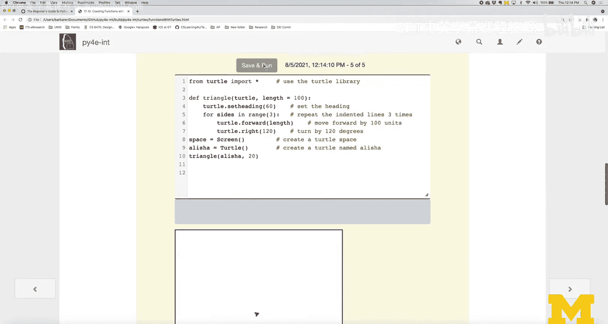
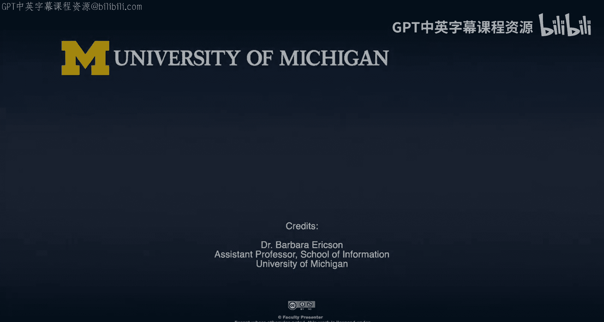

# 密歇根大学《创造性编程（创意、面向对象、debug、QA）｜Creative Coding： Hands-On Python》中英字幕 p66 18_创建实用函数.zh_en -BV1ef421S7Bc_p66-

So now that you've seen how to convert a code into a function。 let's try it with this。

 We're going look at this code first。 if we save and run the code。

 we'll see that it'll draw an equilateral triangle。 It triangle over each side is the same length。

 and it draws it so that the bottom line is horizontal so that we can use it again later to create like a roof of a house。

 simple child's house。So。If we want to convert this code， we want to of course。

 define the function before we call it so we can grab the things that we need to do the triangle function。

 we can put them after the import so we can start with define triangle and I want to take a length and we can set a default for it value in case somebody doesn't specify it。

 we'll paste these items in here， well to fix the indentation here。

And then we also make sure that we pass in the turtle and we could just call it turtle。

 it doesn't have to be turtle， but it is a turtle object。 So now instead saying Alicia here。

 we're using the local name of turtle So everywhere we hit say Alicia， let's change it to turtle。

And then if we run that。Oops we forgot to actually call it right so you have to make sure that you actually call the function otherwise you won't see it happen。

 so let's call the function passing in Alicia and someone we passed in Alicia we get to the function that name turtle will also refer to that same turtle as Alicia。

So if we run that。But we also forgot to specify the length。

 let's try specifying the length maybe of 20 and run it。Oh， but it drew the same size。

 Why did it do that we forgot to actually use that past in length or as what we're using as the side length。

 so let's do that。

And then of course， we could modify it to draw multiple triangles we could pick up the pen in between and now draw a bunch of different triangles。

