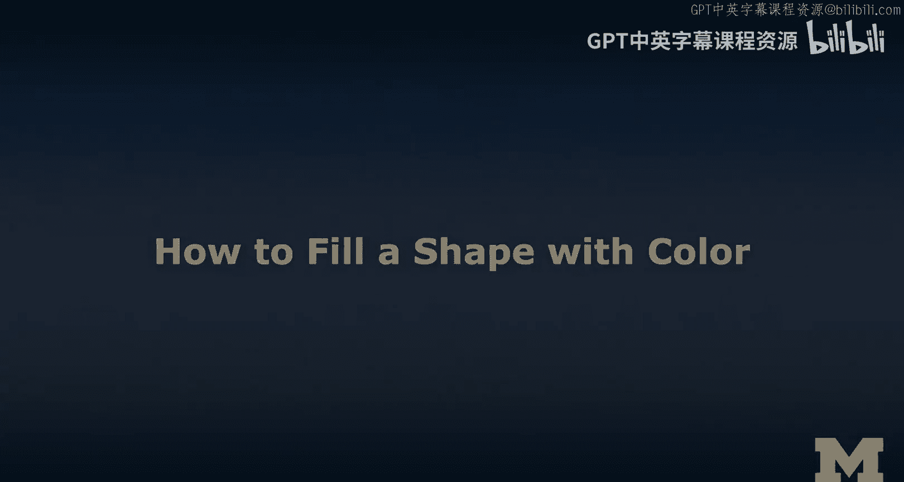
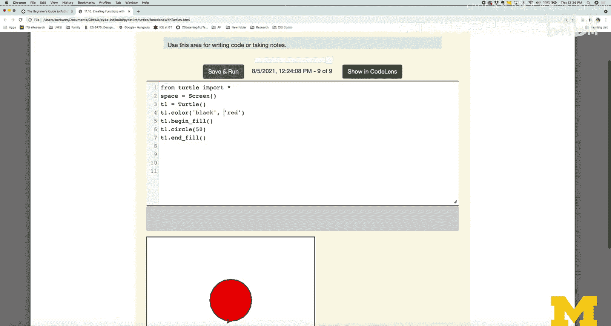

# 密歇根大学《创造性编程（创意、面向对象、debug、QA）｜Creative Coding： Hands-On Python》中英字幕 p67 19_图形颜色填充技巧.zh_en -BV1ef421S7Bc_p67-

So how can I fill a shape with a color？ So let's look at one way we can do this。

 So here's some code that when I run it， I see creates a filled circle。

And all I have to do is really start a fill before I draw the shape and then。End the film。Now。

 the color here， I've just set the regular using T1。 color。

 So I've imported the turtle module so I can use the turtle。

Classes that I've created a screen object called space。 I've created a turtle object called T 1。

 I've set T1's color enough， I just do one color here。 It sets the pen color to red。

 and that'll be used for both pen color and fill color。 and then I can begin the fill。

 drawaw my circle of radius 50， and then end the fill， and I see that。Do that。

I can also just specify the fill color instead of both the fill color and the pen color。

 And then let's see what that does。 Notice it draws the outline of this shape with black because black is the default pen color。

 So here I've set just the fill color。 I can also specify both the pen color and the fill color。

 When I set the color。 So the first color will be the pen color。

 The second color will be the fill color。

So that's ways you can fill a shape。

