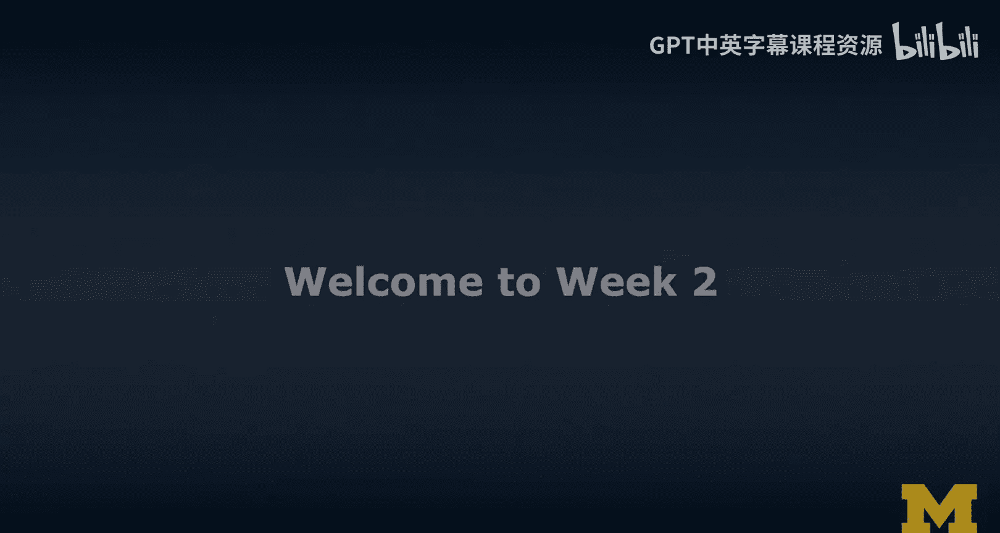
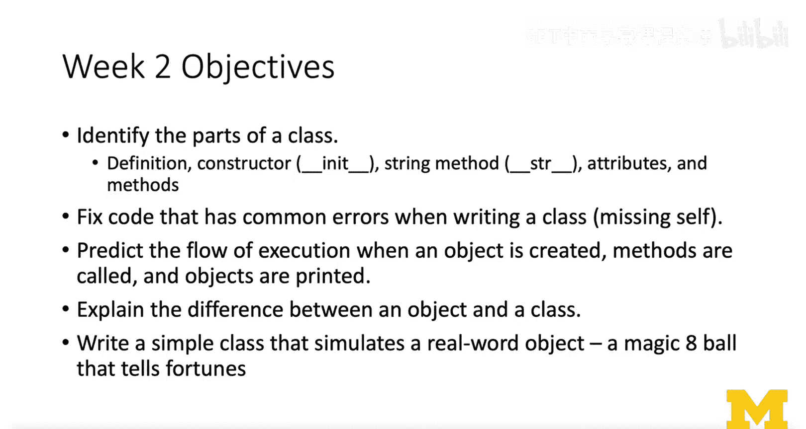
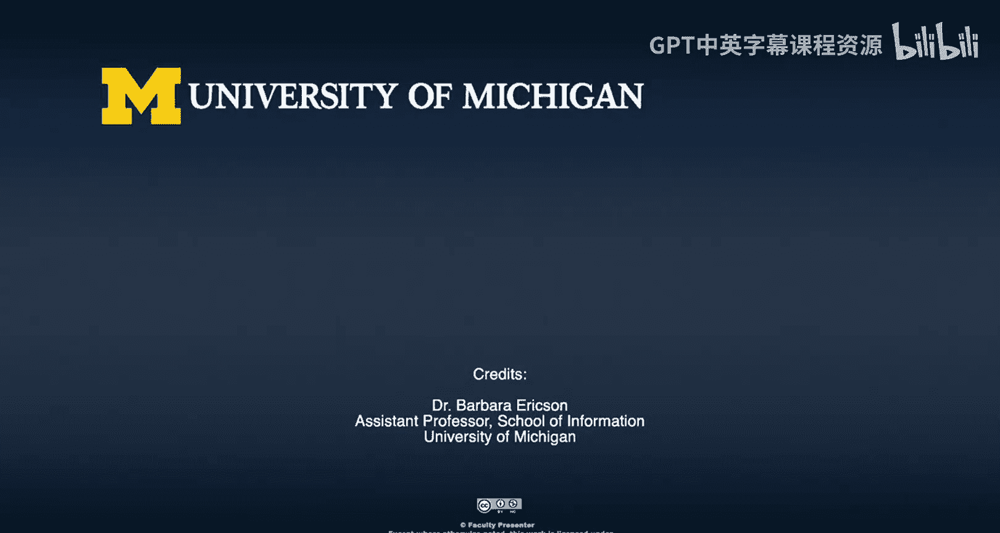

# 密歇根大学《创造性编程（创意、面向对象、debug、QA）｜Creative Coding： Hands-On Python》中英字幕 p68 20_欢迎进入第二周.zh_en -BV1ef421S7Bc_p68-

Welcome to week two。 What are we going to do this week Well。

 we're going to learn how to write simple classes so you're going to learn how to identify all the parts of a class。

 What's the definition of the class， Where's the constructor， the in knit method。

 Where's the string method。What are the attributes and what are the methods You're going to fix code that has common errors when you start creating classes。

 such as forgetting to write the self when you're passing in as a parameter。

 you're going to predict the flow of execution when an object is created when methods are called when objects are printed。

 you'll explain the difference between an object and a class。

 and you'll write a simple class that simulates a real world object。

 something like a magic eight ball that you can shake and get answers to。

 But rather than giving you a yes， no or maybe so or try again later sort of answer like a magic eight ball does。

 it can tell you a fortune like you're going to ace a test。 So good luck。😊。

