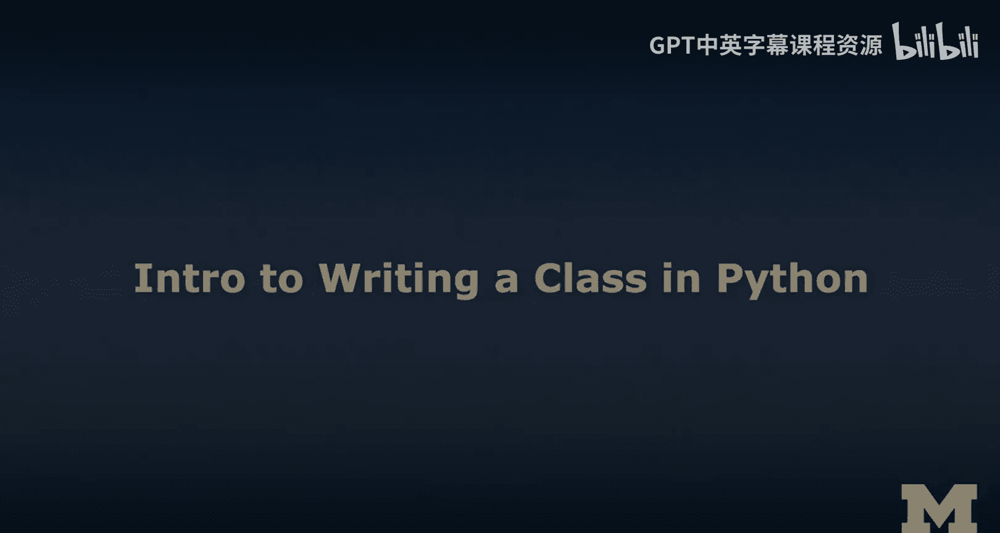
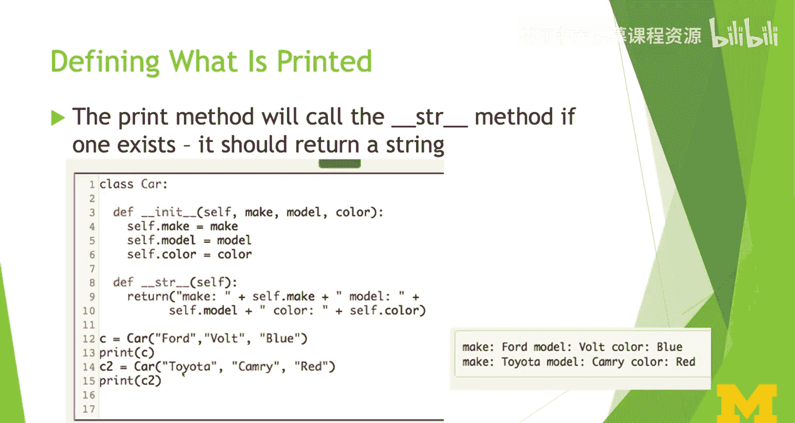
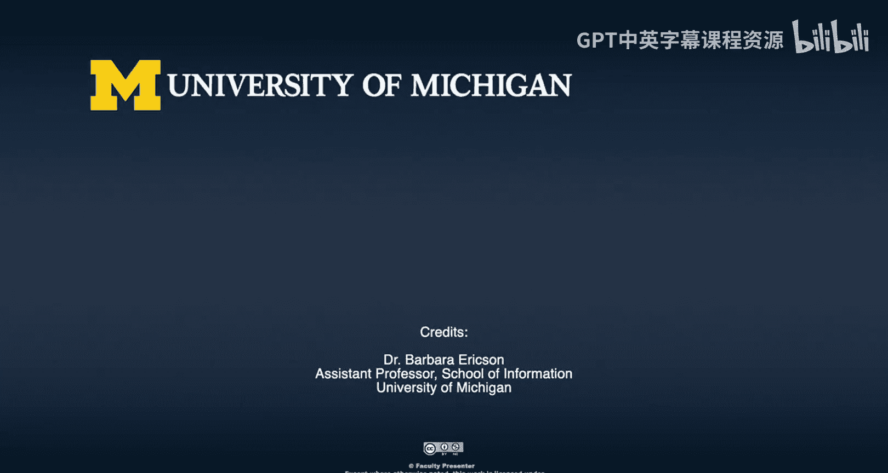

# 密歇根大学《创造性编程（创意、面向对象、debug、QA）｜Creative Coding： Hands-On Python》中英字幕 p69 21_Python类编写指南.zh_en -BV1ef421S7Bc_p69-

So how do we define our own classes in Python？And what we do is use the keyword class followed by typically an uppercase letter starts with an uppercase letter。

 the class name。 So if we' were going to define a car class。

 we would have class and then uppercase C car colon to say here's the start of the class。

 And then just putting a pass in their means。 but that's all we really have to have for the class。

 And then I can actually create an object with that class using and name it。

 So here I have lowercase C equals create a new object of the class car per and print。

 and then print the type of C。 And I see what prints class underscored or remain。

 underscored underscored do car。 So we've defined a class and've created an object that class。

 It just doesn't have any information in it yet。 So we can expand on that。

So that what pass does is just let our code compile， even though it's not quite finished。

 that's a keyword in Python and you'll see that in your homework sometime in our starter code that there'll be a function that has a pass in it so that you have to finish it。

But what does it take to actually define a card， what would you expect to ask a car about itself？

 And so if somebody ask you what kind of card do you have。

 usually what you'll say is a make model maybe a color。

 so let's add that information and there's a special name for the function that we use in a class to initialize the object attributes。

 the attributes for that object or the data about that object and that's called the underscore underscore in knit underscore underscore method。

 So in it but with underscores around it。So we say class car。

 and then we say define that method in it that takes self the current object plus a make model or color and then sets a current object' make to the make current object model to the model and the current object color to the color。

 Notice I can reuse these names。 but theyre really talking about two separate things。

 the self dot make model or color talking about the objects attribute。

 whereas just make model and colors talking about the local variable。

 And then when I initialize those things。 and I say C equals car with a make a model and a color and print C。

 I still just get the car object again， the main car object， it doesn't pretty useful information。

 If we want useful information， we add a string method， underscore underscore STr。

 underscore underscore method。 And when I print an object， that method it called automatically。

 and the results of it， it should return a string that's information about that object。

So we're going change that method override it is what we call this in object current programming。

 There is an inherited method that just prints class name， but we want more information。

 So instead of just printing the class name， we return a string and we can use string concatenation here to put those pieces together。

 So make colon string plus self do make plus the string model colon plus self model plus color plus self do color。

 you do need to say the self all the time， unlike some other languages where if you leave off the self。

 it will automatically add it for you， that does not happen to python。

 So if I create an object of a car that has know for makemod color， For volt blue and I print C。

 then I'll see it'll say make forward modelvolt color blue。

 And if I make a different one with a make of Toyota Camry red and print that then I'll see that information。

 So that's very important stuff that you do when you first start creating classes。

 you have your ni method to initialize the object attributes and you have your STR。

ethod or string method to print information about that object。

