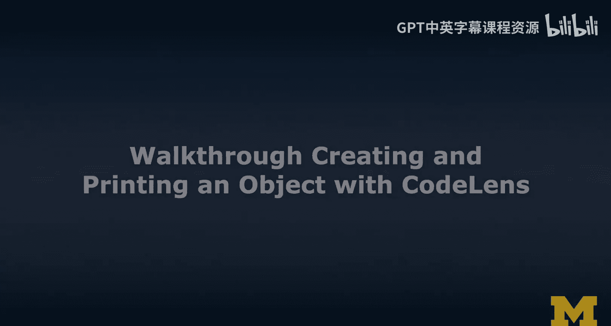
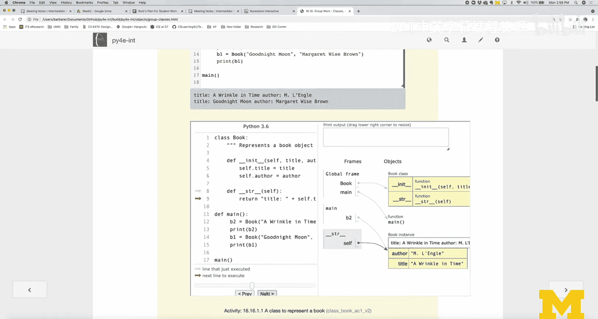
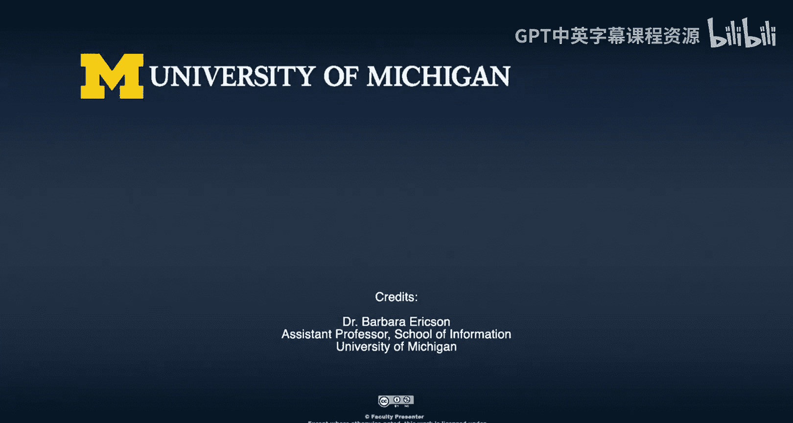

# 密歇根大学《创造性编程（创意、面向对象、debug、QA）｜Creative Coding： Hands-On Python》中英字幕 p70 22_CodeLens对象创建调试.zh_en -BV1ef421S7Bc_p70-

So let's walk through what happens when you create an object of a class and then you print that object。

 So here we have the book class。 And if we run it， we see that prints out a title colon。

 a wrinkle in time， author。Meedalline L。 And so how is that happening。

 So if we show in code lens what's going on here。 Remember。

 we can always walk through the code with code lens and we can just step through the code to see what's happening。

 The first thing it'll do just like we did what we're defining functions。 It'll define the class。

 Next， it'll define the main method。 Then it'll execute the main。

 So we'll see it go back to number 11 line number 11。 and then start to create the object。

 So in line 12， we're going create this book object and initialize its variables or its its attributes。

 So if we go into that， we see that we call the init function。 So automatically。

 when you create an object， it calls the underscore underscore knit underscore underscore function。

And so that takes in self the current object， which is a reference to a book instance or an object of that class。

 as well as the title and the author， and that it'll set those information in that object so I see the title get copied from the original past in variable and I'll see the author get copied。

So the initializers or constructors are also called initialize the attributes in an object。

Then when we're done with that， the next thing we're going to do is print it。

 when I say print an object， what it does is look for an underscore score STR method。

 underscoreer score， and then print the result of that， what that returns。

 And that'll return a string。 So we'll see that return a string。 and then we'll see that get printed。

 So that we see that print。 So that's what happens when you can use code lens。 Remember。

 to walk through exactly what's happening when you create an object from a class。

