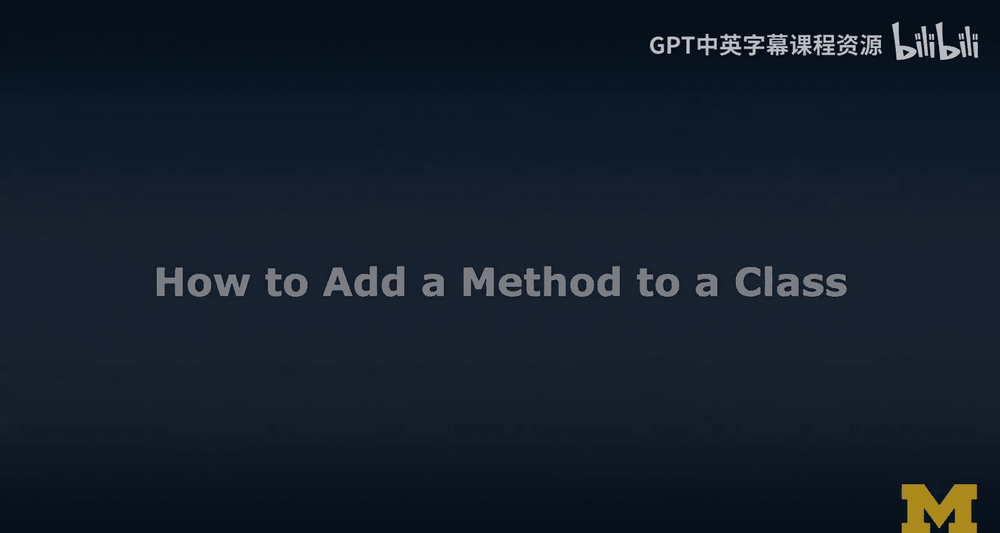
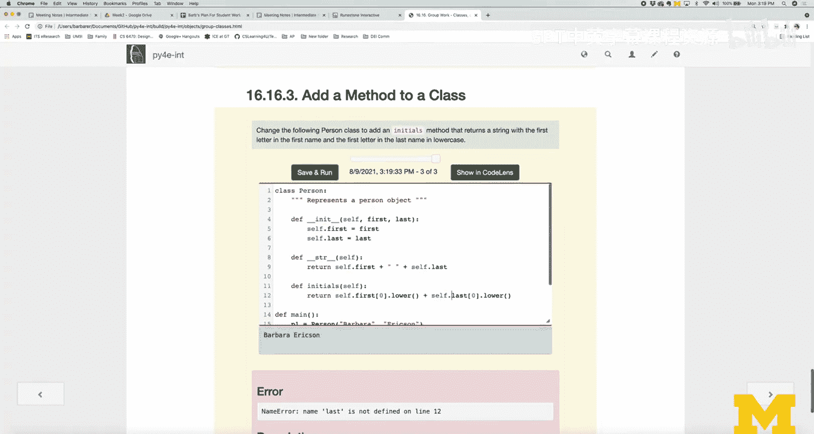
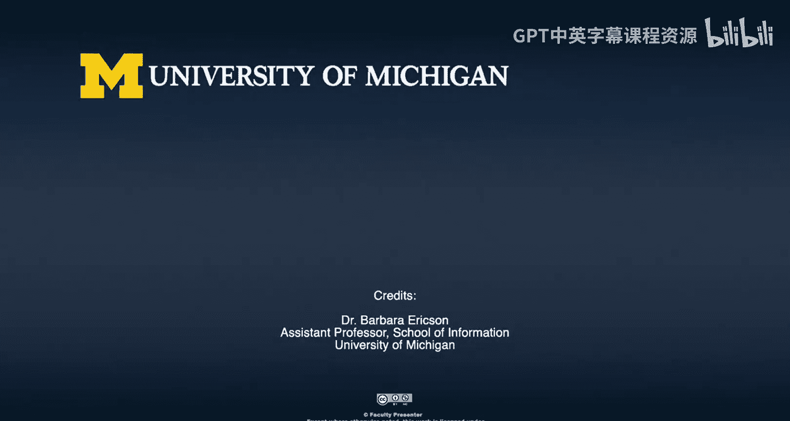

# 密歇根大学《创造性编程（创意、面向对象、debug、QA）｜Creative Coding： Hands-On Python》中英字幕 p71 23_类方法添加教程.zh_en -BV1ef421S7Bc_p71-

So what if we want to add a method to a class， It's pretty easy。 So just like these other methods。

 we have the init and the string method， we can add another method。

 and we are asked to add an initials method。And we always have to remember to pass in the self。

 the current object。 And then we can return。 We want to get the first character of the first name and then make sure it's lower case。

 and then add to that the first letter of the last name， which is self dot last。

 The first letter would be at index 0。 and we can use lowercase to initialize that。

So if we do that and run this， we'll see that it prints the initials。 And that's another method here。

 So definition initial self， remember to pass the self。

 And remember to use the self when you're working with the attributes。

 If I left off the self and try to compile it， I see that it says。

 I don't know what you're talking about。 What's last。 So I have to add the self in the front of that。

 So that's how you can add a method。

