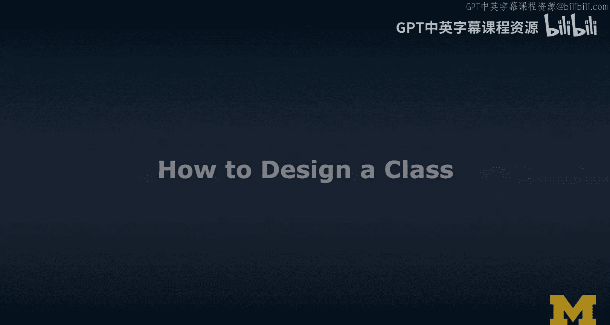
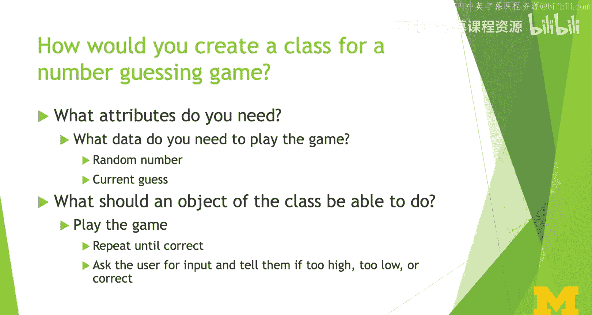

# 密歇根大学《创造性编程（创意、面向对象、debug、QA）｜Creative Coding： Hands-On Python》中英字幕 p72 24_类设计方法论.zh_en -BV1ef421S7Bc_p72-

When my kids were little， I often would occupy them by saying I'm thinking of a random number from  one to 100。

 you guess， and I'll tell you if you're too low， too high or correct。

And we could do that in code as well。 So what would we need to do that。

 So whenever you're thinking of creating code for a class。

 you want to think about what are the attributes or the things the data that the object that this class needs to keep track of。

 And the things I said was I'm picking a random number from one to 100。 So there's my number。

 And then there's your guess。 And so those are the two attributes that we would be interested in having or need to have。

 And then we need to be able to play the game， So that would be a method or a behavior we would expect from the game。

 So we would need attributes of the random number that you've picked。 we could call that nu。

 for example， And then what's the current guess we could just call that guess。

 And then there'd be a play method that's going to repeat until you get it correct。

 which would mean a while loopop。And where each time that you're not correct。

 we're going to ask the user for input and then tell them if it's too high， too low or correct。

 So let's try to write the code for that。

