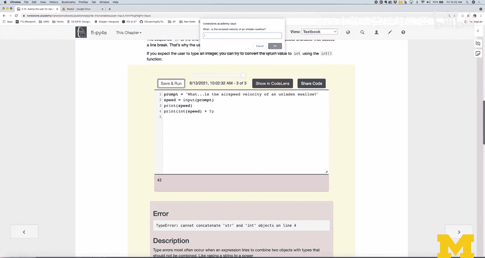

# 密歇根大学《创造性编程（创意、面向对象、debug、QA）｜Creative Coding： Hands-On Python》中英字幕 p73 25_用户输入获取.zh_en -BV1ef421S7Bc_p73-

When you're playing a game often you want to get input from the user and so to get an input there's a built in function and Python called input。

 let's take a look at how this works。So you can ask for input and you can include a message that you want displayed to the user and then that'll return something so you need to grab whatever that's return in order to use it again and you could for example。

 print it so I could run this。 I see it little pops up a little window that asks the question。

 what is your name and I could put my name in there。

And this always comes back as a string Now what happens if you're trying to get a number here。

 so especially if you want to do some sort of arithmetic with the number that you get as input。

 well in that case， what you need to do if I said 42。

Is convert it from a string to an integer before you do any sort of math with it so make sure then you can use the built in function int to do that。

 What happens if you forgot to do that if you didn't convert it to an int， let's try。

So I type in the member and then I get an error that I can't concatenate a string and an int object。

 so I would need first to convert that I don't have to convert it before I print it。

 Pri it is fine because it's a string。

But I need it if I'm going to do arithmetic with it。 So remember， you can use input to get。

Information from a user， but it'll always come back as a string。

 so if you want to treat it as a number you're going to have to convert it to int。

