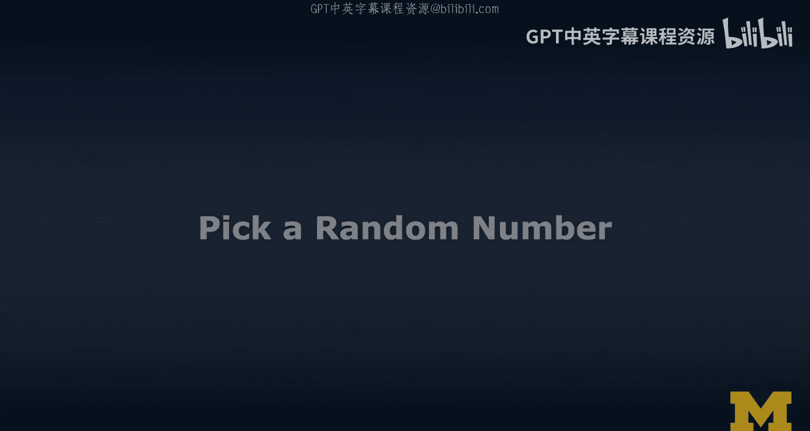
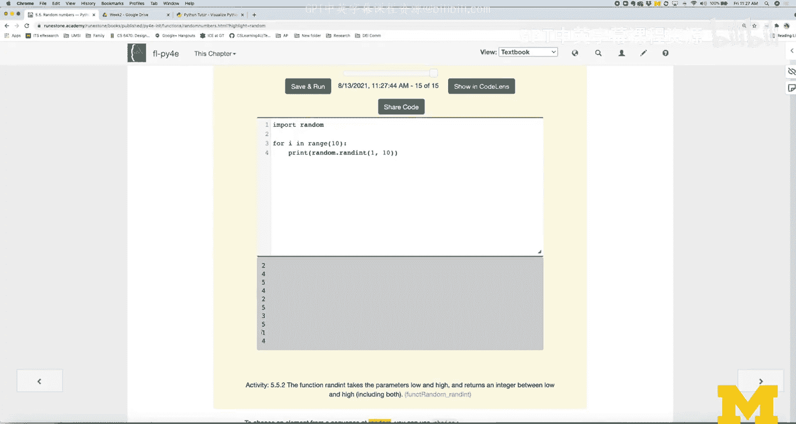

# 密歇根大学《创造性编程（创意、面向对象、debug、QA）｜Creative Coding： Hands-On Python》中英字幕 p74 26_随机数生成实践.zh_en -BV1ef421S7Bc_p74-

So when we're playing the number guessing game， one of the things we're going to need to do is to generate a random number between one and 100 so how do we do that Python has a library or a module called random that lets us do things like that So let's take a look here we have import random because it's we're importing a module and we're going to loop 10 times printing the result of calling in the random module the random function and then we'll print that so let's try that。

And I see what that does is give us a value and it does between zero and not quite one。

 so we can see we have values pretty close to 0， but not quite 1， so 0。94。Well that's okay。

 but what if we wanted one to 100。 Well， there's another function that we can use for that。

 so there's a ran int function that actually gives a low and a high value and returns something between the low and high value inclusive of that low and high value so let's see that if we loop a few times rather than so I'm going to loop。

For I in range 10， soute 10 times。And I'm going to do randomant from one to 100 because that's what we want to do in our game。

 and I have to indent that。So if I do that。Here occurred after the end of the code。Oh。

 I'm missing a right parentheesis。Make sure you have those。And actually。

 let's try  one to 10 right now。 just so you can see how this works。 So 1 to 10。

 I see we do have one。 we don't have 10 yet， but if I run it again， I do see we get 10。

 So Rdent will let you take a low and a high and we'll give you numbers between that low and high。

 including the low and high。 That'll be useful for a numb guest game。

