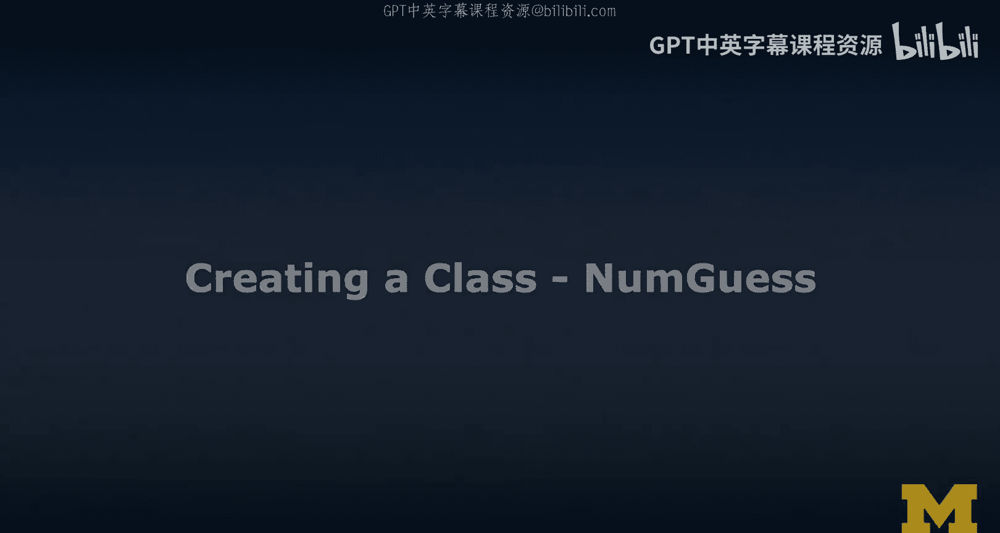
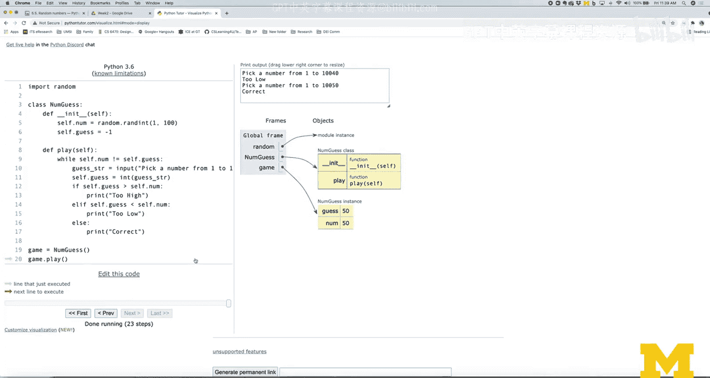

# 密歇根大学《创造性编程（创意、面向对象、debug、QA）｜Creative Coding： Hands-On Python》中英字幕 p75 27_创建NumGuess类.zh_en -BV1ef421S7Bc_p75-

So now that we know how to get input from the user and how to pick a random number。

 let's create our class。So we're going to import random first。

Because that's a module that we need to use to generate a random number。

 we're going to create a class， we don't define a class， we don't say deaf。

 we say class and then the name of the class usually start with an uppercase letter and you can combine uppercase letters when you have more than one word。

 so I'm going to use capital nu guess。Then I want to define the init method or the constructor。

 and I don't need to pass anything in。 So except for self。 I always have to have self。

 but I am going to initialize some attributes。 So I'm going to initialize the nu that。

The game is picking from the random module dot， and I'm going to use the R int。

 and I'm going to say it from  one to 100 so that should pick a random number between one and 100。

And then I'm also going to initialize the current guess to be negative one。

 that's outside my range of one to 100。 so that sort of indicates to me that we don't really have a real guess yet。

Now I'm going to define the play method that also is going to have to take self。

 remember you always have to take self if it's an object method。

 something that works on the current object， and we just use self by convention to refer to that current object and we're going to play as long as that guess doesn't equal that number so while and self dot nu oop dot。

Does not equal self dot guess， and the current object number does not equal the current object's guess。

Then we're going to get another input from the user to pick another， ask them to pick another number。

 and that's going to return a value。 So we need to name that。

 So I don't want to just call it self done guess because it's going to return a string and we want to convert it to a number。

 so I'm going to call it the guest string equals input of pick a number。From 1 to 100。

And I'm going to convert it now， so I'm going to now set self done yes equal to。

 and I use the int function， the built an in function to convert from a string to an in。

And now we can check if self dot guess is a greater than the self dot nu。

 So that that random number we're looking for， then we've guessed too high。 So print。Too high。

Otherwise， we have total three options so we can use LF self。 guess is less than self。 nu。Print。

Too low。Else。Oops， need my colon。Print。Correct。Now that just defines the class。

 and I have to actually create an object of it， and I do that by using the class name， so none guess。

 but and I'm going to create an object， so I want to name it。

 so I'm just going to call it my game equals and I use the class name with parentheses that would translate into this in that takes itself because it's going to use it on the current object。

And then I'm going to tell the game to play。 and again， the play method only takes self。

 so I don't need to pass anything else in。 So let's try that。So if I say next， I import that。

 I now define the class。I now create the game object， so I see it's a numb guess instance。

And of course， that when I create a game object， it's going to call the initializer。

 so I see it set the self， it picked a random number， it picked 50， not very random。

And then it sets self gas to negative  one。And now I can play the game。 So when I play the game。

 it's going to check self do numb does not equal to guess。 So we're going to go ahead。

 We're going to ask the user to pick a number。 and that comes up down here。 I know it's 50。

 so I'm not going to pick 50。 I'll pick 40。And then it will now check。 It'll convert it to a number。

 and check it。Oops， I have an error。 Gu underscore string is not defined。 Gu string。 Oh。

 I spelled it wrong。 oops， let's edit that code。Try again。So again， to import the module。

 create the class， create the object of the game， which will of course call the init method。

 sets up those things。 Now we call the play method。

While the self dot known is not equal to the self do guess and it's not， we ask for input。

 we see the input down here， I'm going to enter 40。Submit。

And now we're going to check that if it's too high， it's not。 if it's too low。

 it's going to print too low。 we see that print here。And now we're going to try again。

 So it's asking me for input again This time I'll pick correct。 I'll pick 50。

So it'll now check again。 is it too high， No， is it too low， No， otherwise it's correct， and that'll。

Come back when we come back to the wild now self。no does equal self。 guess。So that will end the game。

So that's one way you can code this。

