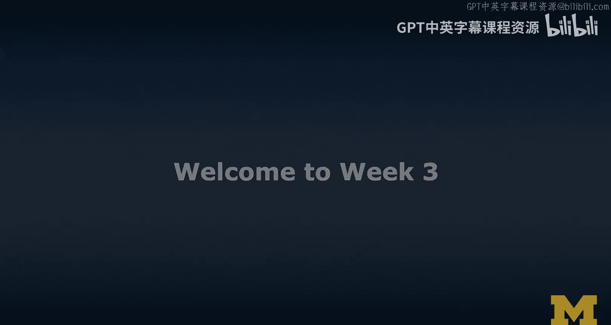
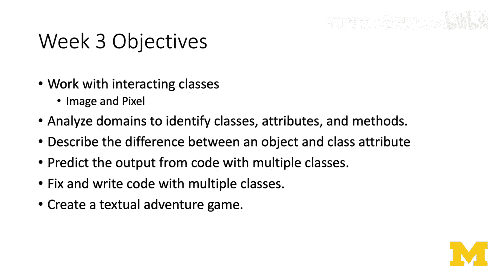
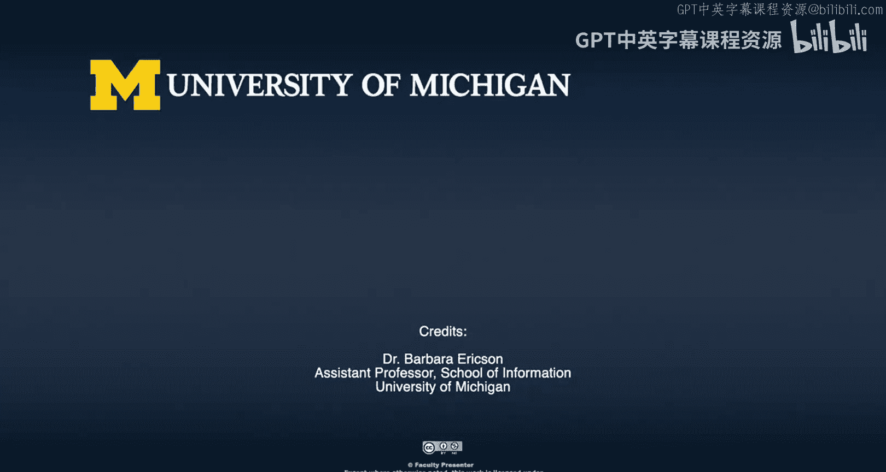

# 密歇根大学《创造性编程（创意、面向对象、debug、QA）｜Creative Coding： Hands-On Python》中英字幕 p76 28_欢迎进入第三周.zh_en -BV1ef421S7Bc_p76-

So welcome to week three。This week what you're going to be working with is interacting classes。

 so multiple classes， particularly you're going to be working with images and pixels。

 So doing picture manipulations or image manipulation。

 you're also going to analyze domains to identify the classes， attributes and methods。

 you'll describe the difference between object and class attributes and you'll be able to predict code output from code that has multiple classes and you'll be able to fix and write code that has multiple classes and at the end of the week you'll create a textual adventure game。

 so I hope you have a great time。😊。

