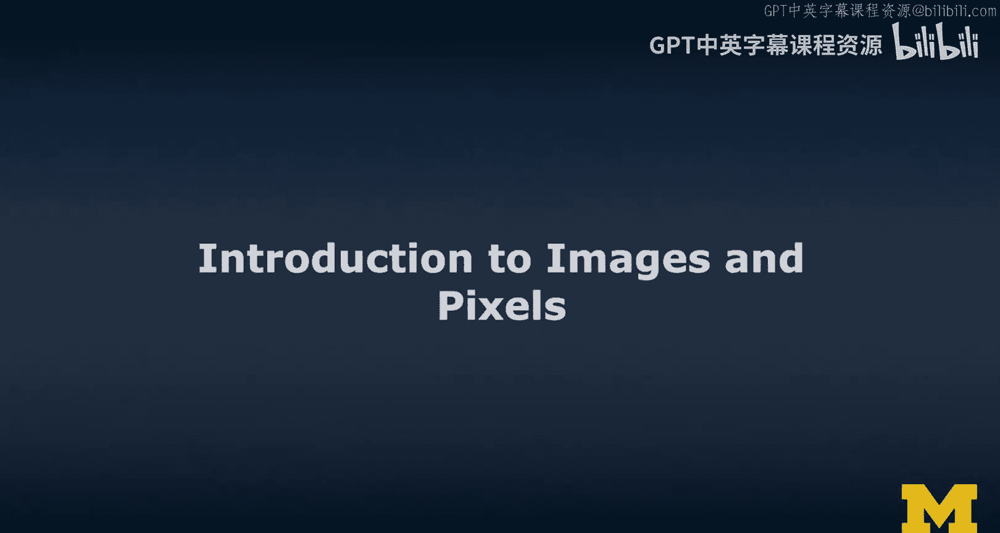
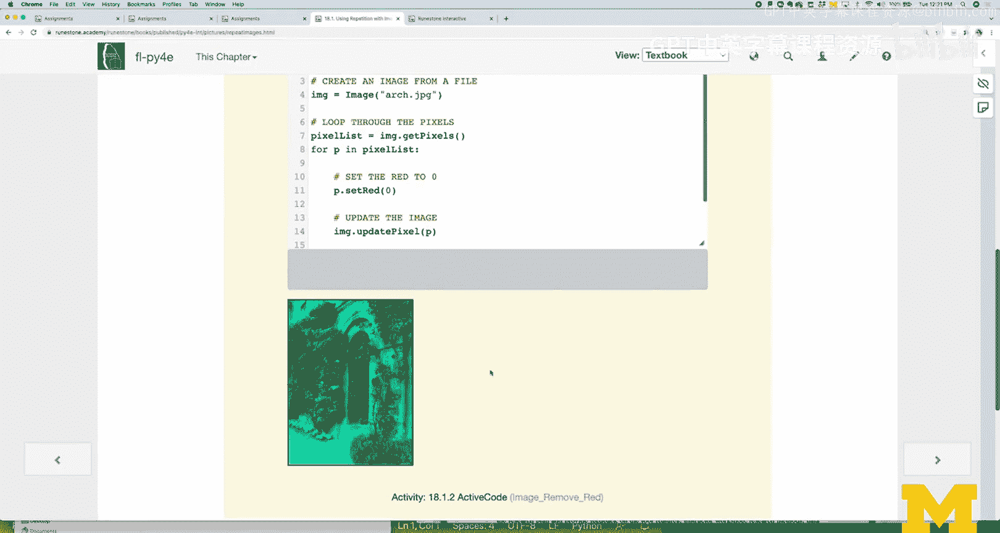
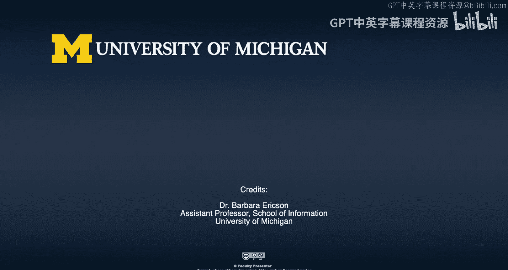

# 密歇根大学《创造性编程（创意、面向对象、debug、QA）｜Creative Coding： Hands-On Python》中英字幕 p77 29_图像与像素基础.zh_en -BV1ef421S7Bc_p77-

So let's look at the code that works on an image or a picture。 First thing you have to do， of course。

 is import the image library that defines the classes that we're using to create images。

 then we can create an image object So from a file name， so arch。 JPG。

Then we can ask the image to give us a list of all of its pixels so we get a list of pixel objects。

 So images have pixels， and we can loop through the pixel list。 So for P in pixel list。

 and we can set the pixels red。 So using set red of 0。

 And then we can update the pixel and the image。 So we've changed the red。

 but we also have to update the image。 And then we can show the result by getting a window and drawing the image in that window。

 And when we do that。Because we're setting the red to zero。

 what we're going to see in a moment takes a little bit of time。

Is that the original arch looks like it's being seen through a green filter because what we've done is reduce the red。

 So it looks more blue greeny。 This is sort of how water works。

 Water reduces the amount of red light that comes through。 So that's why water looks blue green。

 So that's a bit about images。

