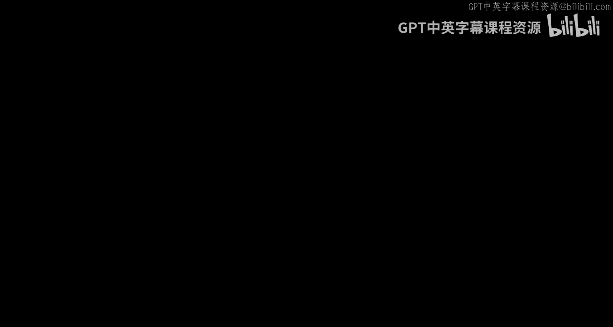
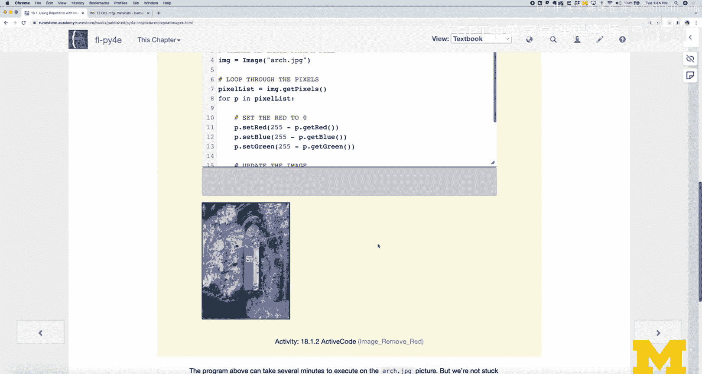
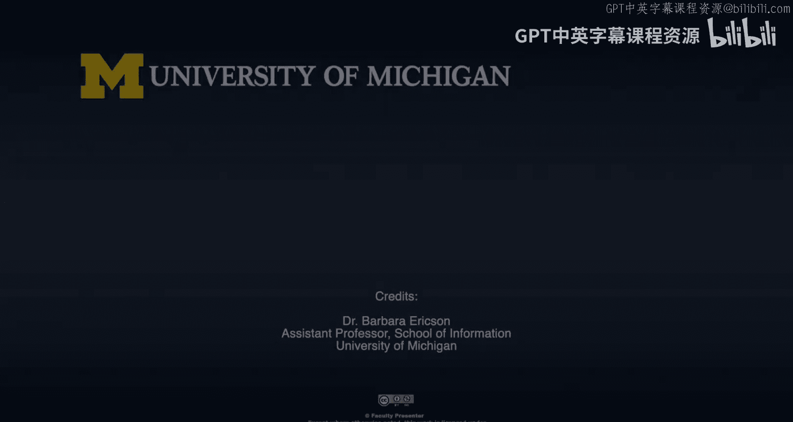
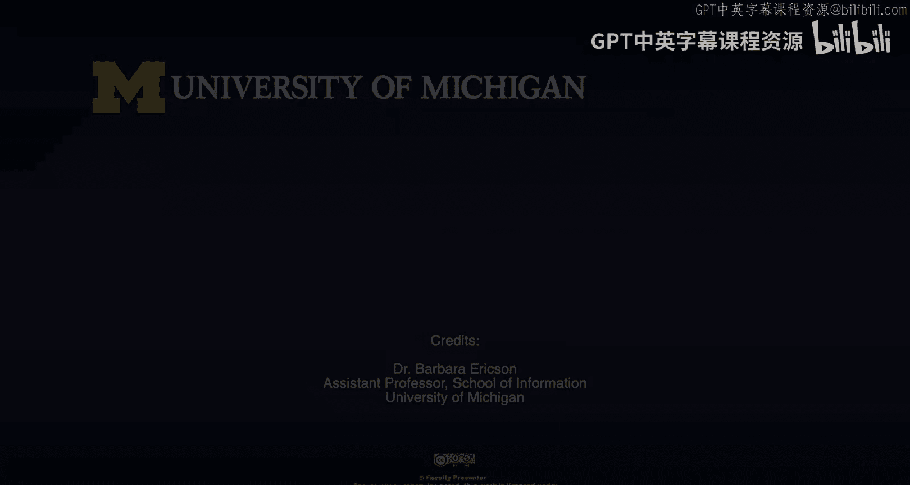

# 密歇根大学《创造性编程（创意、面向对象、debug、QA）｜Creative Coding： Hands-On Python》中英字幕 p78 30_创建负片图像技术.zh_en -BV1ef421S7Bc_p78-

So years ago， when we used to develop film， we'd get back these negatives。

 and they'd be the inverse of the colors in the actual picture。 So how could we do that？ Well。

 so if the color was originally 0， we'd want it to be 255。 And if it was originally 255。

 we'd want it to be 0。 If it was， say 100， it could be 255-100。 So let's try 2。

55 each of the original red， green and blue values。So here we'll start with。

 instead of setting red to 0， we'll say 255 minus， and we can get the red as well。At the same time。

 so we can get the original red and then set it to 255 minus that original red。

 and we can do the same thing with blue。 just got to make sure we change it to blue both places。

And then same thing with green。And then if we run that code， instead of before。

 when we were setting the red value to 0， we're getting sort of a blue green filter。

We get this interesting， very ghostly looking result， which is the negative of the image。

So that's a little bit about how to create negatives。

