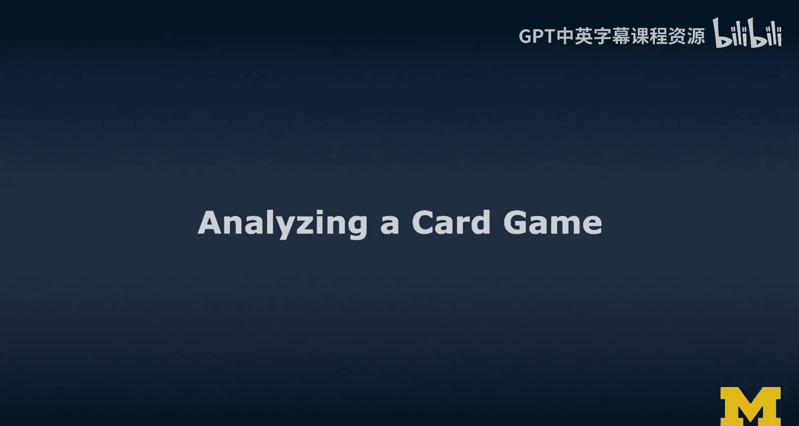
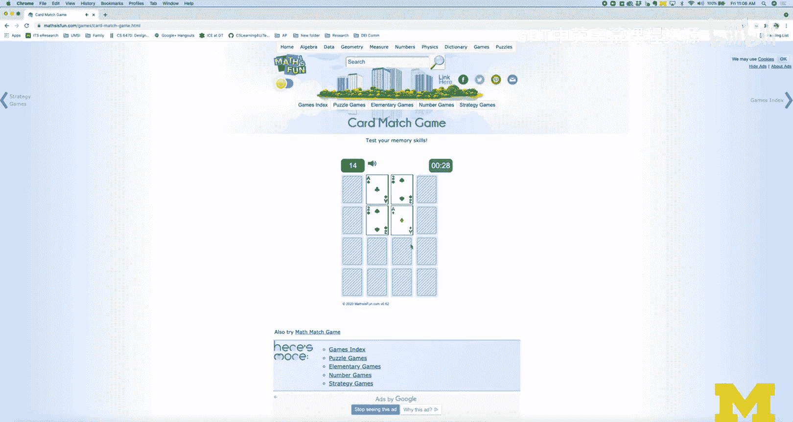

# 密歇根大学《创造性编程（创意、面向对象、debug、QA）｜Creative Coding： Hands-On Python》中英字幕 p79 31_卡牌游戏分析.zh_en -BV1ef421S7Bc_p79-

So most ob programs consist of multiple classes。 Let's start taking a look at some situations like that。

 So for an example here， let's go play this card matching game aces and twos game。 So here's the URL。

 And if I go there。This is what I see。 And so we're going to play the aces and twos game。

 So the very first one。 So we click new game to start a game。

 And then what we can do here is it's a matching game so we can turn over cards by clicking on them。

 And we're looking for matches。 So try to a hearts to a close to a spades。😊，no。There we go。

 So once we find a match， they'll stay up because the the suit and the value both match on the card。

 And so you just keep looking for the a similar the two matches， the two cards。

And that's how you play that game。 So when we're thinking about creating classes to represent this。

 we talk about what are the things that we're working with in the game。

 So what are these things called These are called cards， right， and card has a suit and a value。

 So like ace。Two is the value and the suit here is spades or clubs or hearts or diamonds。

So these are the data that an object of the class would know about itself， if I'm a cur。

 I should know what my student value are， and if I'm comparing cards I should be able to see。

 do they have the same student value？So that also implies that there's behavior right to play this game。

 we have to be able to match the cards to say are they equal。

 are they the same sort of card and then also we have this ability to select them。

 which flips them over and then keeps them over if they match so there's a select option or a flip option so that's how we start thinking about the names the classes。

 what are the classifications of these things， what kind of things are we talking about and then what data or attributes to objects of the class have and what behaviors or methods do they have。

