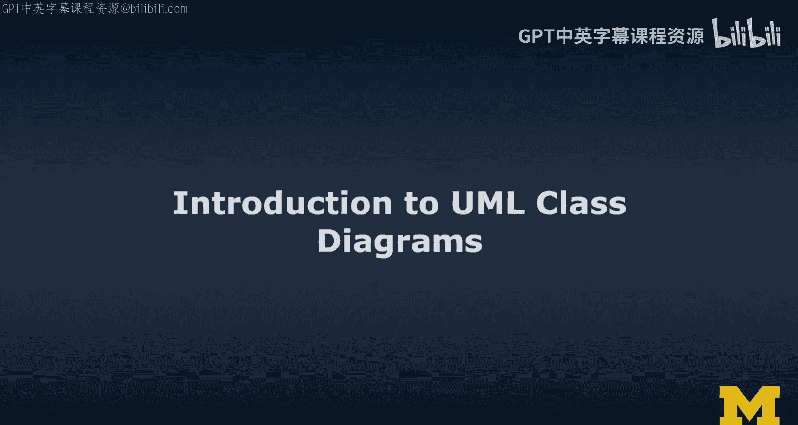
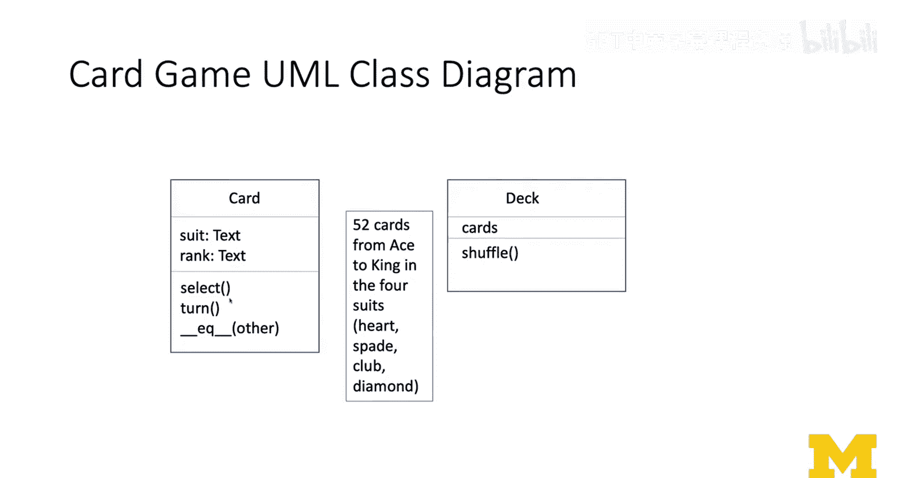
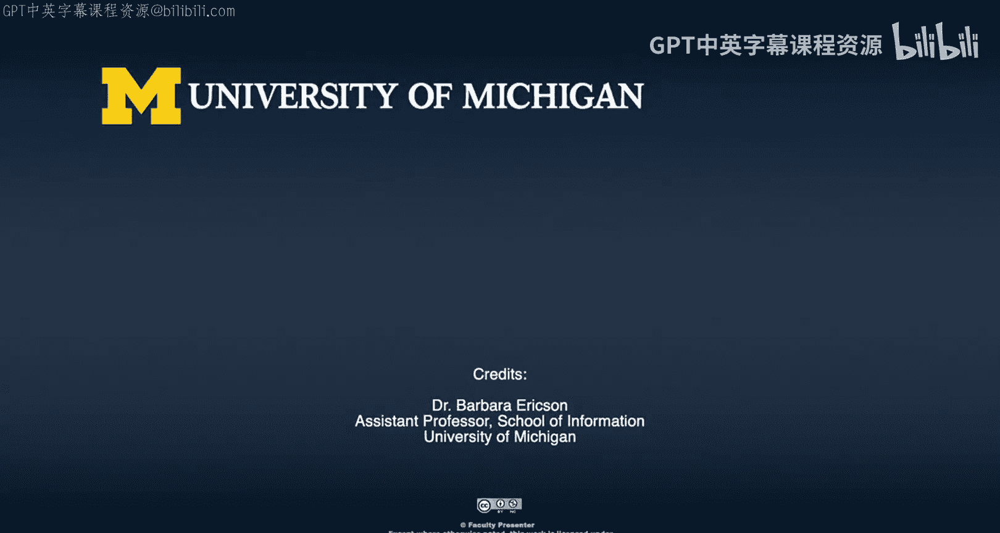

# 密歇根大学《创造性编程（创意、面向对象、debug、QA）｜Creative Coding： Hands-On Python》中英字幕 p80 32_UML类图入门.zh_en -BV1ef421S7Bc_p80-

So now that we've been playing the Aces and twos games。

 one of the things we want to do is figure out， of course。

 what are the classes we're talking about what are their attributes and their methods And a way that we document that is to create a U ML class diagram。

 So let's take a look。 So here's a class diagram for what we were just looking at。

 We have a card class。 And we said it has attributes of suit and rank。

 So is heart spades Club diamonds， Where rank or value would be ace to King。

And then there's behaviors that we can do。 So in the game。

 we would click on the cards to select them So we have a select method。

 we have a turn because that would turn the card over and that we decide whether to keep the card over。

 turn it back。 And then there's a way of matching one card against another to see if they have the same suit and value。

 And when we're breakingking classes， we can use the underscoreer Sc EQ method for that underscoreer score。

 they'll check if two things have the same values。And then when we're talking about cards。

 typically we're also talking about a deck and a deck is a collection of cards in often in an order。

 so there's an order to a deck， and you can do things like shuffle a deck。

 but it makes up when I have a deck we talk about the cards in it。

 So it's basically a list of cards but not just any cards is typically 52 cards in the four suits from ace to King。

 So that gives you a quick introduction to what a UML class diagram is like。

 And so you'll notice that the top of the box So each class is defined in a box top of the box is the class name after that are the attributes。

 and there's another separation and then there's the methods。

