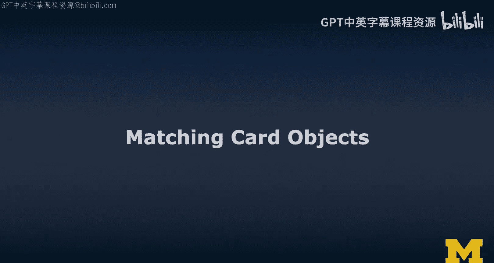
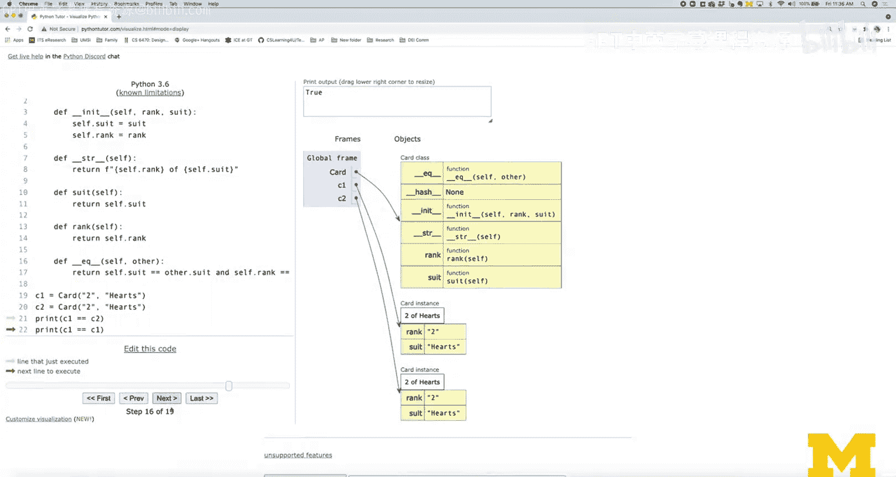

# 密歇根大学《创造性编程（创意、面向对象、debug、QA）｜Creative Coding： Hands-On Python》中英字幕 p81 33_卡牌对象匹配实践.zh_en -BV1ef421S7Bc_p81-

So we've been talking about a card class。 So let's take a look at the implementation in Python。

 so we can have a class card。 We have our initializer that takes， of course， the current object。

 the rank in the suit， or you can think of that as the value and then sets the current object suit and rank。

 We can have a string method that says what kind of card is this。

 So what's the self dot rank and self dot suit。 This is using the F string where you just put F in front of the string quotes。

 and it can be double quotes or single quotes or even triple quotes。 and then in curly braces。

 you put the value that you want to substitute in for the string And you don't have to convert from a number to a string at all using an F string。

And then we can also create what's called getters， where I can return the value of the suit or of the rank。

 So suit just gives you the suit and rank gives you the rank。

 I created two card objects that should both be the two hearts。

 But what happens if I check if they're equal or not using equal equal。

 So I visualize that execution， I'm using Python tutor， which you can always use。

So of course we define the class， that's the first thing we did。

 we create the object by doing creating the object。

 we go to the initializer and we set its object suit and value and rank。

And then we come back here and execute the create the second object。

 So these are two different objects that we're creating that have the same suit and rank。

And then when we check if they're equal， what happens is it goes and checks by default。

 when you create a new class， if you don't specify anything else。

 it's going to only return true if they're the same object。 So let's try if we print。

 if we edit this code and we check。Print。C1 equal equals C1。And now I've try to execute that。

 So that should print。 And we can just click last year to see all the way。 And so that's true。

 So by default， the equal equal is going only return true when it's the exact same object。

 But that's what we want in a card game。 We want them to be。That to be true if therere。

The same suit and value。 So we can add a method。 And it's just like these other underscore methods。

 D it's underscore underscore EQ underscore。 And then we take some other object。

 And then we say if a self dot suit is equal。 So we want to return true is we basically want to return。

 the result of is self dot suit equal to other dot suit and self dot rank。Is equal。To other dot rank。

 so other is the other object。That was passed in， oh， and we also need the self in here。

Oh made the self here and here。So now if we try that。We create our first card。

Come through create our second card。So now when we test print equal equal。

It's going to come and execute this method。And return the value。 And then we'll print it。

 And now it's true because now we've overridden what we call that when we inherit something from a parent class。

 So we inherit this test if it's equal。 but it only is true if it's the same object and we can override it。

 So it'll be called instead of our parent object or parent method。So now both of those will be true。

So that's how we can create the card class。

