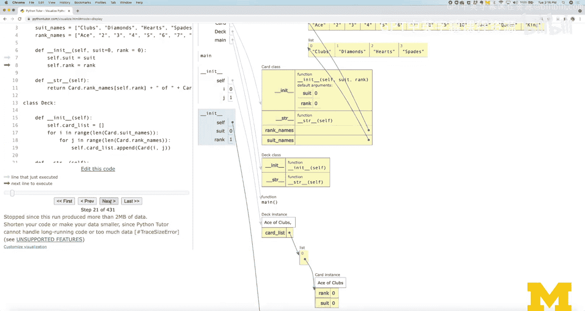

# 密歇根大学《创造性编程（创意、面向对象、debug、QA）｜Creative Coding： Hands-On Python》中英字幕 p82 34_Card类单步调试.zh_en -BV1ef421S7Bc_p82-

So we've been talking about a card class and cards usually belong to a deck。

 and a deck is a collection or a list of 52 cards from ace to King in the four suits so how does that look in Python？

So here we have a card class followed by a debt class， so if I execute using the Python tutor。

 I see that I've defined now the card class， and it has the init in the string method。

 it also has rank names and suit names as lists of these things These exist on the class。

 they're called class attributes rather than object attributes because not every card object needs to have the same list。

 it would just be a lot of wasted space。 So instead we put it on the class。

Now we've created the deck class。 It has the init in the string function for that。

 We have our main function。 and now we're going to call the main function。

 In there we're going to initialize or create a deck。 When I create the deck， of course。

 calls the in in the deck class。 and we set the card list to the empty list。

 and then we loop through for I in range of all the suit names。

 So0 to the suit length of the suit names， and then 0 to the length of the rank names。

 and then we create that card When I create a card， we call the card init method。😊。

And we set that object's suit， we see that happening here， and then it's rank。

 and so now that's the ace of clubs and we add it to this list。And so then of course。

 we can do the next thing， create the next card， and that'll create the next one。

 and we see that we've now created the two of clubs。

 and this code will continue to repeat through from a to 2 to 34 all the way up to King in clubs。

 and then it'll do the next suit in the next suit。 So that's how card and deck work together。

