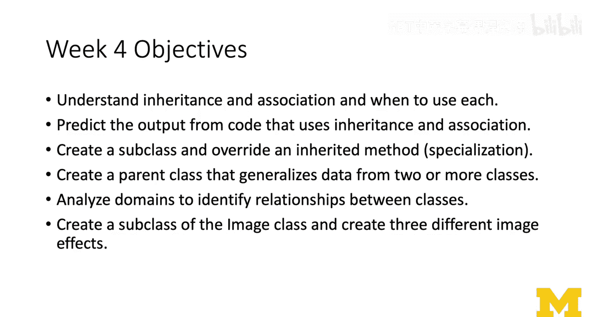
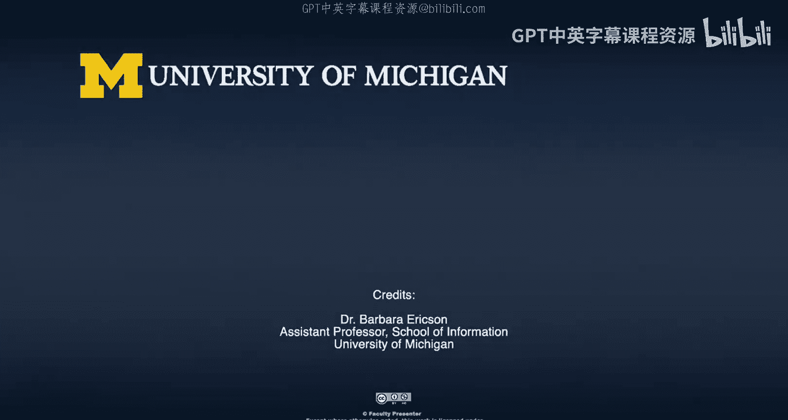

# 密歇根大学《创造性编程（创意、面向对象、debug、QA）｜Creative Coding： Hands-On Python》中英字幕 p83 35_欢迎进入第四周.zh_en -BV1ef421S7Bc_p83-

So this week we're going to talk about relationships between multiple classes。

 so there's two basic relationships， inheritance and association or is a type of or has a。

 and we're going to talk about when to use each You're going to be able to predict the output of code that has inheritance and association。

You'll create a subclass an override inherited method that's also called specialization。

 you'll create a parent class that generalizes from two or more other classes。

 so pull out the generalization from into the parent class and then have the children class inherit from the parent class will analyze domains to identify relations between classes and as an assignment you're going to create a subclass of the image class and create three different image effects so I hope you have a good time。

