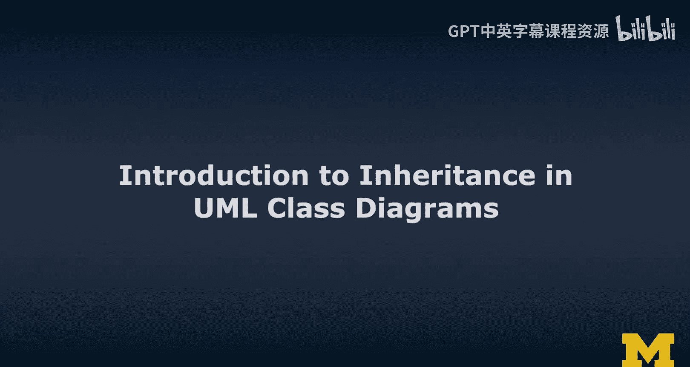
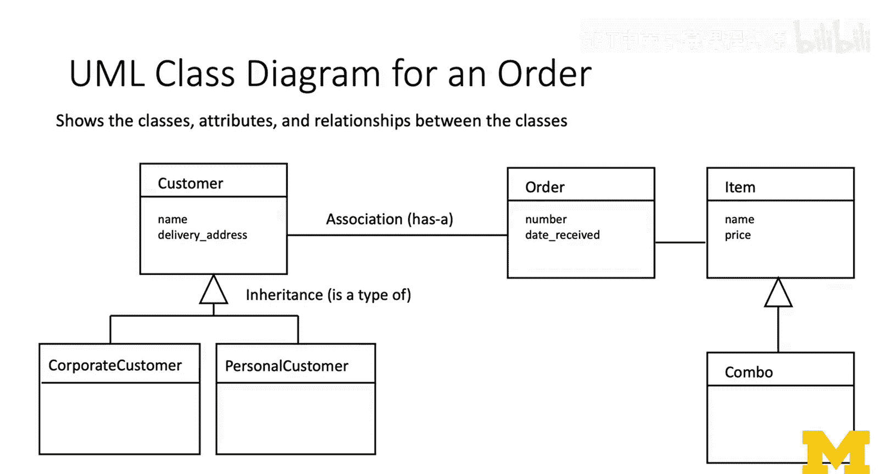
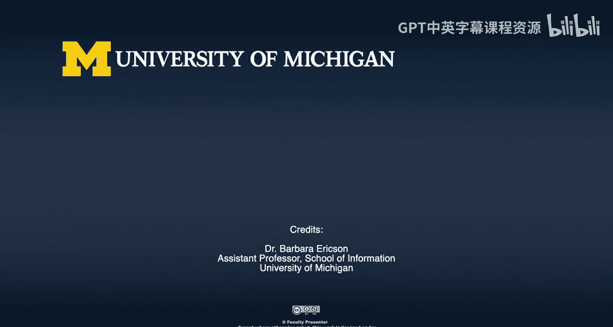

# 密歇根大学《创造性编程（创意、面向对象、debug、QA）｜Creative Coding： Hands-On Python》中英字幕 p84 36_UML类图继承机制.zh_en -BV1ef421S7Bc_p84-

So there's two basic types of relationships between classes in a UML class diagram。

 one is the association or has a links， we might say that a flight has an airport。

 it actually has two airports associated with it there's a departure airport and an arrival airport。

We might say that a movie。Showing has a movie associated with it。

 so a movie showing is per movie with a certain day and time。In this U ML diagram。

 we're looking at a customer has a name and a delivery address。

 and it has an association or a straight line link has an association with an order。

 So a customer has an order， an order has a customer associated with it。

 an order might also have an order number， It might have the date received。

 and then an order might also have a list of items in the order。 So for each item。

 there may be a name or an I D or a price。And then there's another type of relationship which is shown by this triangle。

 which is an inheritance relationship that says that one class is a parent of another class。

 so what this is saying is that a customer is a parent class and there's two kinds of customer。

 there's a corporate customer and a personal customer。

You might have different discounts for a corporate customer versus a personal customer。

 there might be rewards program for a personal customer。

And then another inheritance relationship here in this diagram is a combo and a combo when you've gone to maybe a fast food restaurant。

 they might say hey order combo1， which gives you maybe a sandwich and a drink and fries or chips or something So combo typically is multiple items it's a kind of item you can order it but it is a combination of multiple items and then the price is calculated by adding up the price of each of the items。

 but maybe multiplying it by some discount， so maybe 0。9 or 0。8。

So this is a very simple class diagram to show you the two major relationships。

 the association with a straight line link and the inheritance or the open diamond to show the parent and the child is the one doing the inheriting。

 so that's a quick introduction to both inheritance and association。

