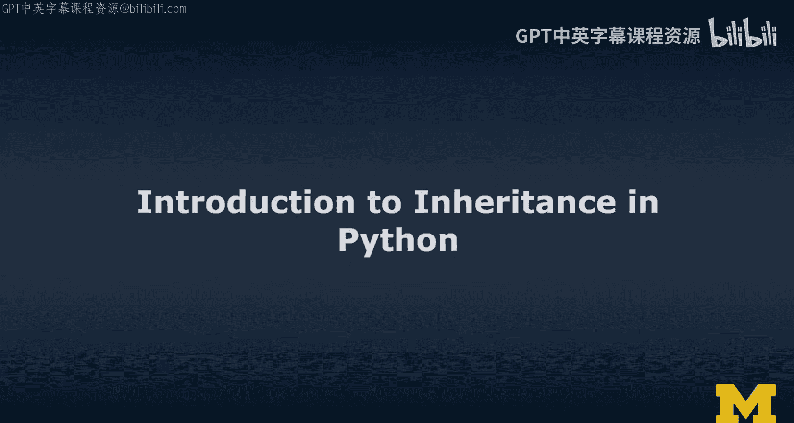
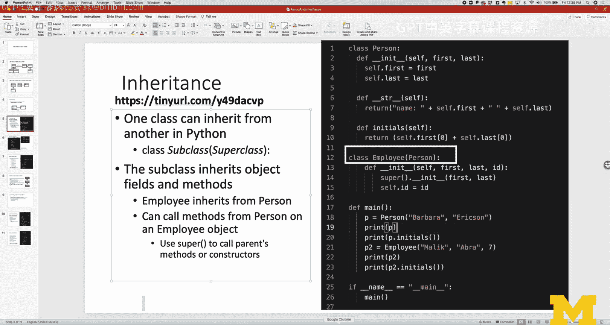
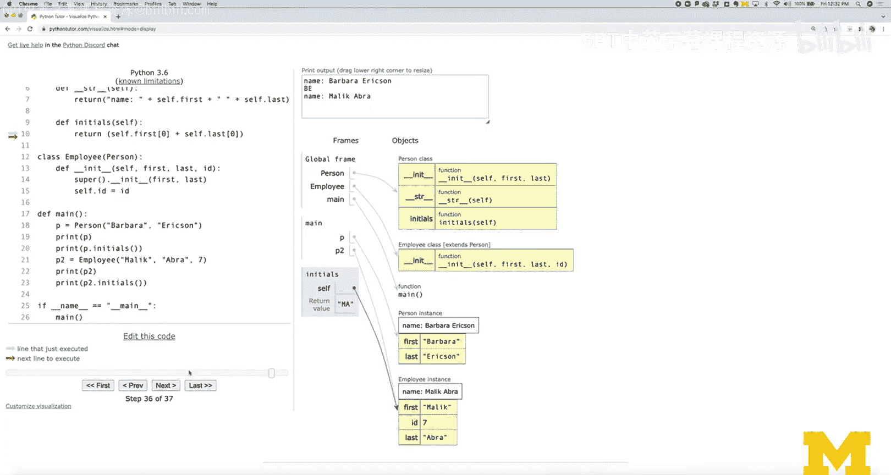
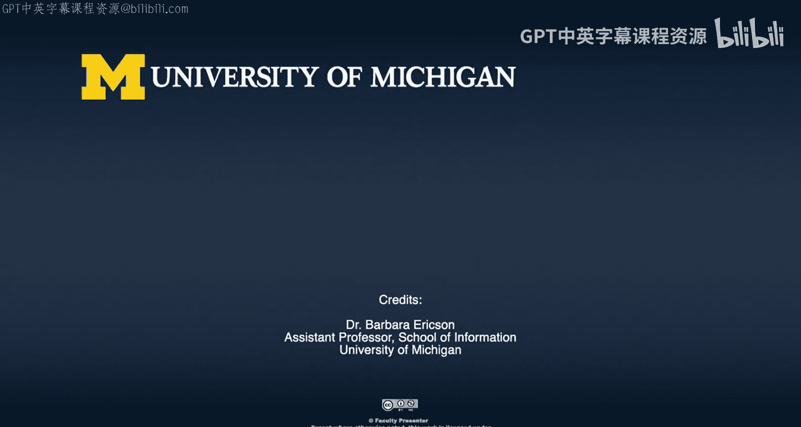

# 密歇根大学《创造性编程（创意、面向对象、debug、QA）｜Creative Coding： Hands-On Python》中英字幕 p85 37_Python继承实现.zh_en -BV1ef421S7Bc_p85-

So let's see how inheritance works in Python， so you can have one class inherit from another class。

 That means that the second the subclass or child class inherits attributes as well as methods。

 So let's look at this。So here we have an example of inheritance and you can use this URL to open this up in visual in the Python tutor。

And here we have a class person that has a first and last name。

 we can print the first and last name if you print the object of the class， we can get the initials。

 we could also declare a class employee that inherits from the class person。

 so in the parentheses after class employee we say who are we inheriting from。

 that means we can get all their attributes and methods。

And that means that if I call the same method name on the employee class。

 it'll look for the employee class first for that method and that would be executed instead of an inherited one from the person class。

 but I can still call an inherited method if I use super per and per end to get back an object of the parent class。

To get back the class， the parent class， and then I can call methods on that and so let's see how this works。

We're going to go to Python tutor to that URL。 So if I say next first thing to do is declare the class person。

 so we see they have the in method， the string method， the initials method。

We clear the class employee and notice it says employee class extends person。

 so as a child of or subclass of and then in our main method we define our main method and we say。

 okay， if this is the current thing that's executing， let's go ahead and execute the main。

 so that'll go and execute the main。First thing we do is create an object of the person class。

 when we do that， of course， we will go to the init method in person and we'll go ahead and initialize this person instance。

To have that first name and last name， we can see now we've copied these local variables into that object。

And then we're going to print that person， which will call the string method。

 So that's going to return。That name plus the first。

 the self do first name plus the space plus self do last name。 And we see that get printed。

Then we're going to call print the result of calling P dot initials。

 so we go call P dot initials and we see we're going to return the first character。

 the first name plus the first character in the last name， so we see that return value B E。

 and we print that。Now we're going to create an object of the class employee。 So again。

 we go now to the inni method employee。 Not we don't start at the one in person。 This is an employee。

 so we started the init method in employee。And because we want to set that first and last name。

 we can just reuse that code from the person class。

 So we use super Pren Pre dot underscore underscore knit。

 underscore underscore to call that in method in the person class。 So when I execute this。

 we'll go to that init method in person。 and that'll again in this employee instance。

 it'll initialize the first name then the last name。

 and then all we have left to initialize is the Id。

 So we go back to the in method in the employee class and we initialize the I。

 And so now we have this here。In this object。 And now， if we print that object， we're going to go。

There is no string method in the employee class so we don't override it。

 so we're going to go ahead and execute the one in the person class。So that will return the endprint。

 the first name and last name。And then we can ask again for the initials， again。

 that something it inherited employee inherited in person。

 So to go and execute that in the person class。And it'll return those initials MA。

 and we'll see those print。

So that's how inheritance works in Python。

