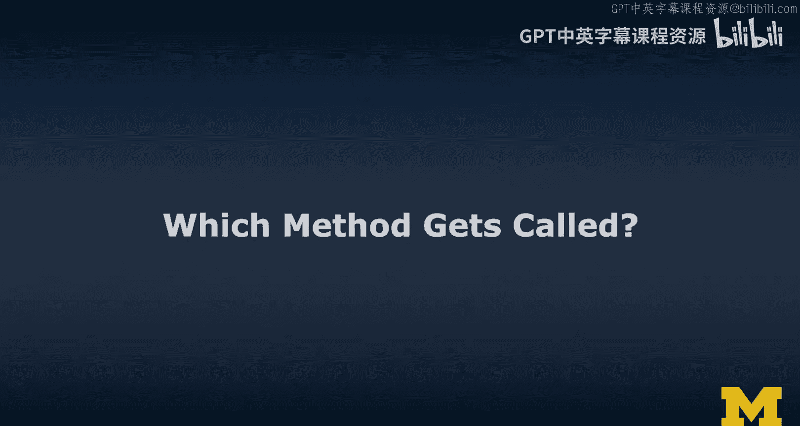
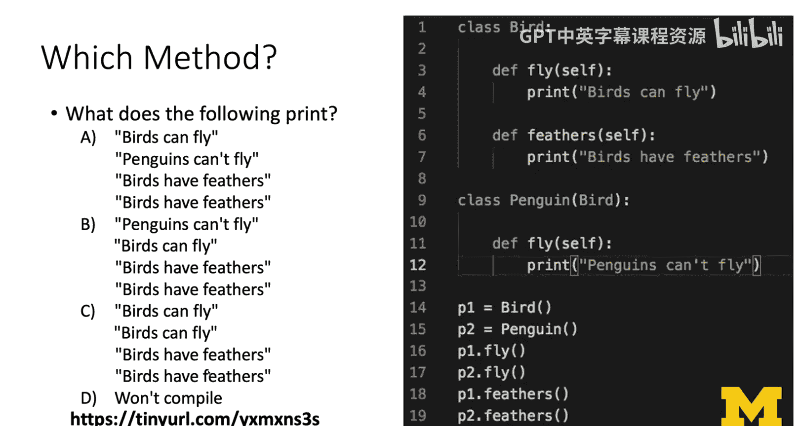
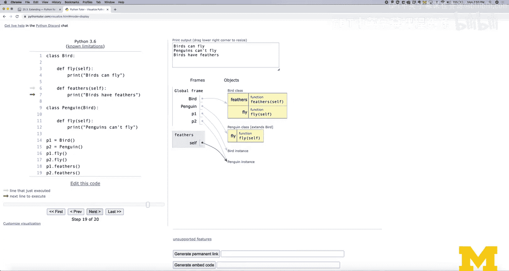

# 密歇根大学《创造性编程（创意、面向对象、debug、QA）｜Creative Coding： Hands-On Python》中英字幕 p86 38_方法调用优先级.zh_en -BV1ef421S7Bc_p86-

Take a look at this question。 We have a class bird。

 and then we have a subclass or a child class called penguin that inherits from bird。

And there's a fly method in bird and a feathers method in bird and a fly method in penguin。

 And then we create a bird object and a penguin object。 And we ask each of those。

 the bird object to fly， the penguin object to fly the bird object to。Excate the feathers method。

 the bird object to execute the penguin object to execute the feathers method。

So what's going to be the output of that， We can look at this URL。

 which is Python Tutor to see exactly what happens。

So here's the code in Python tutor。 and we can go all the way to the beginning。

 And if we execute this code， the first thing we do is define the first class the bird class with the feathers and fly methods。

 Then we define the penguin class， which extends bird or a child of bird or a subclass of bird。

 Then we create a bird object， an objects know what they are。

 They'd keep a reference to the class that create them。 So P1 knows it's a bird instance。

 P2 is going to be created as a penguin instance。 an object of that class。

 Then we're going to ask P1， the bird instance to fly。

 So what that's going to do is go look in the bird class for a fly method and execute that。

 So that's going to print birds can fly。Then we're going to come back。

And we're going to execute on P2。 Remember P2 is a penguin instance。

 We're going to execute the fly method。 So that's going to go to the penguin class first and see if there's a fly method and there is。

 It'll execute that one。 So now we'll see that penguins can't fly。 Penguins can swim。

Then we're going to come back and we're going to call P1 dot feathers。

 So P1 again is a bird instance。 So we'll look for the feathers function or method in that class and we see it。

 and we'll execute that。 and they'll say bird have feathers， birds have feathers。

Then we'll do the same thing with P 2。 But P2 is a penguin instance。

 So it'll first look in the penguin class。 There is no feathers method there。

 So it'll go up to the parent class and execute the one in birds。 So again。

 it'll say birds have feathers。

So remember that objects keep track of a class that created them。

 And that's where they start looking whenever you execute a function or a method。

 They say okay that in my class， if it is， I go ahead and execute that one。

 even if there was one in my parent class with the same name。

 That's called overriding up an inherited method。 But if there isn't one there。

 it'll go then to the parent class。 There isn't one there。 it would go to the grandparent class。

 And it would keep going until it found it， because it wouldn't have compiled if there wasn't one to execute。

 So that's a little bit about how。When an object， when a method is called it an object。

 it decides which method to execute。

