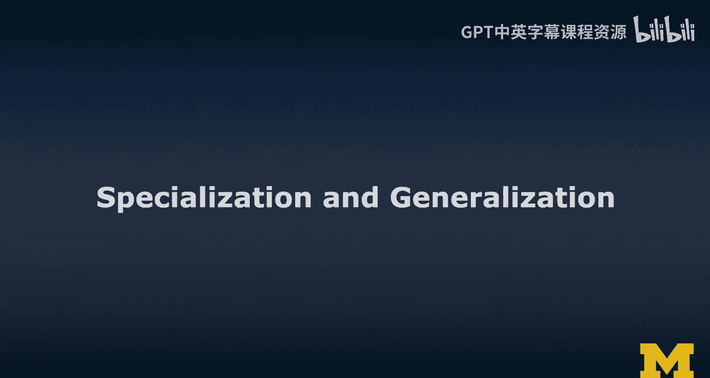
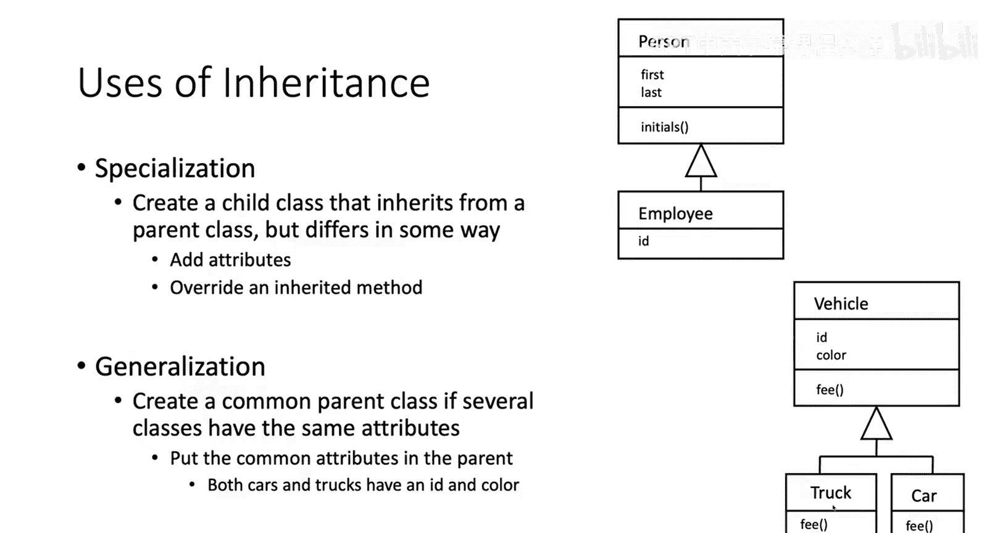
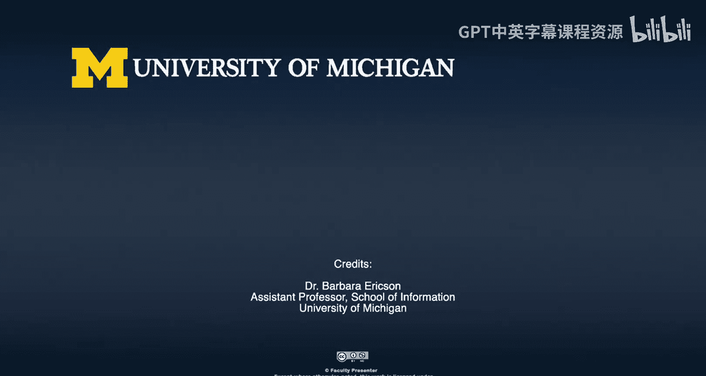

# 密歇根大学《创造性编程（创意、面向对象、debug、QA）｜Creative Coding： Hands-On Python》中英字幕 p87 39_特化与泛化技术.zh_en -BV1ef421S7Bc_p87-

So there's two major ways that we use inheritance。 One is specialization。 unlike my parent。

 but I want to be different in some way。 So specialized， I could add attributes。

 I could override inherited methods。 So， for example， if you have a person class。

 and a person has a first and last name and a method where get you initials from that first and last name。

 you could create an employee class that inherits in person。

 an employee is a kind of person and you could add the attribute I D。

 And then if you had several classes that have the same attributes， you can pull out a parent class。

 that's called generalization。 What's what's the generalization of those specific children。And so。

 for example， if we were the State Department collecting fees on vehicles。

 we might have cars and trucks that had an ID in a color and you could pull those attributes out into a vehicle class that has an I in color and a method fees。

 and then you could override the fees for cars and trucks， maybe trucks are more expensive。

 So two major uses of inheritance， specialization and generalization。

