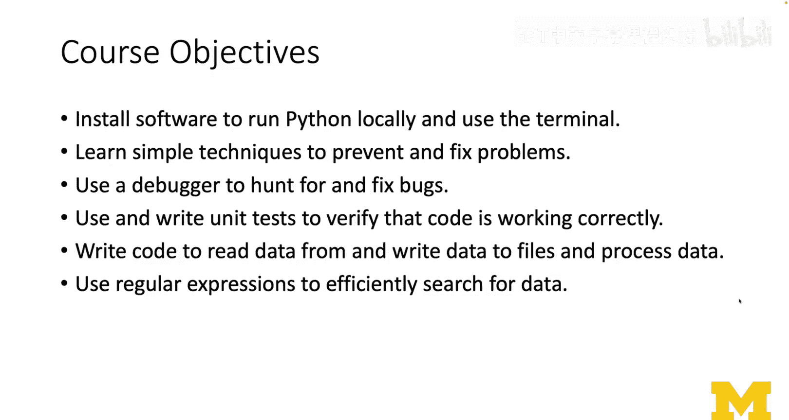
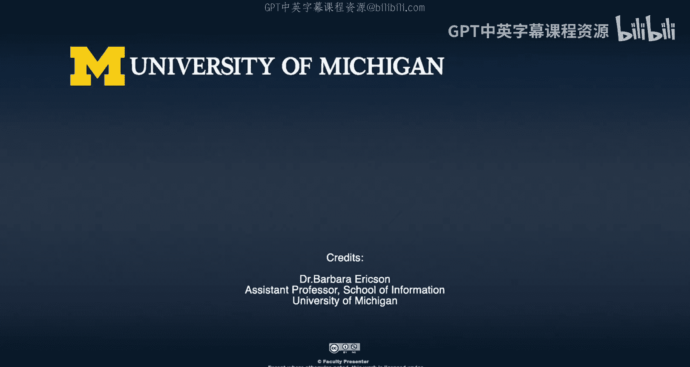

# 密歇根大学《创造性编程（创意、面向对象、debug、QA）｜Creative Coding： Hands-On Python》中英字幕 p88 0_欢迎来到第三课程.zh_en -BV1ef421S7Bc_p88-

Welcome to the course In this course， you're going to install software so that you can run Python locally and you'll also use a terminal window。

 which is an oldst way to give commands to the computer。

 You're going to learn simple techniques that let you prevent and fix problems。

 You'll use a debugger to hunt for and fix bugs。 you'll use and write unit test to verify that code is working correctly。

 you'll write code to read data from and write data to files as well as process the data。

 and you'll use regular expressions to efficiently search for data so have a great time。

