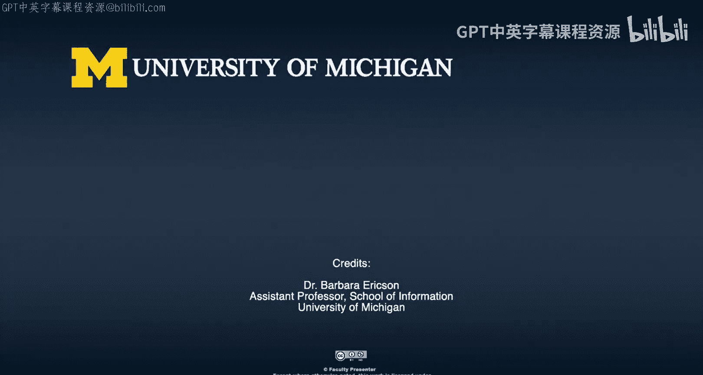

# 密歇根大学《创造性编程（创意、面向对象、debug、QA）｜Creative Coding： Hands-On Python》中英字幕 p91 3_为何分组协作.zh_en -BV1ef421S7Bc_p91-

So one of the things I want you to do in this course is work in groups。

 but why should you work in a group Well there's a lot of research that shows that working in groups is both more motivating and improves your learning。

 partially it makes sense because you have to explain to other people what you're thinking and just doing that can help you understand things better。

 it's also more fun usually to work with other people and it can help you from keep you from getting stuck。

 especially why you're programming。And in general， research shows that diverse groups perform better than individuals。

 groups often can solve problems that individuals can't， if you've ever worked in an escape room。

 right you may have been able to escape with the help of other people that you may not have been able to do on your own。

Also important is that group work or being able to communicate with others， work in teams。

 manage yourself， manage others is very important to employers so having those kind of skills also is useful in the workplace so that's why I think you should work in groups。

