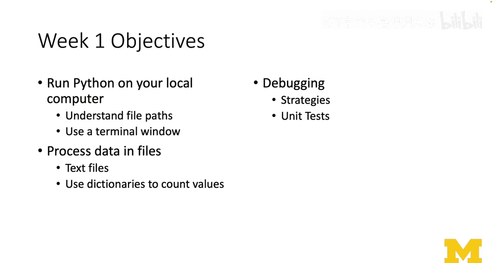
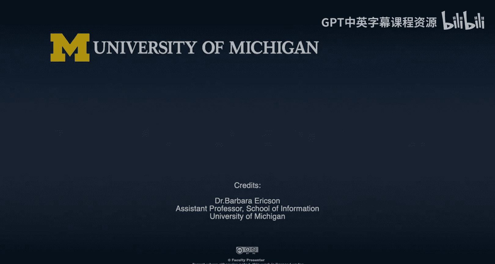

# 密歇根大学《创造性编程（创意、面向对象、debug、QA）｜Creative Coding： Hands-On Python》中英字幕 p95 7_欢迎进入第一周.zh_en -BV1ef421S7Bc_p95-

What are you going to learn in week one in week one。

 we're going to learn how to run Python on your local computer。

 which means we have to understand how file paths work and also how to use a terminal window。

 as well as we're going to install Anaconda and a visual Studio code so you'll learn how to use an IDE or an integrated development environment also to run your code。

You're going to be able to process data from files so you're going to read text files and use dictionaries to count values in the files and then we're going to learn a little bit about debugging。

 like what strategies can you use， how do you can prevent from even having problems so you don't need to debug but once you do have a problem or a bug。

 how do you find it and solve it and also how do you write unit test to automatically test your code enjoy the week。

