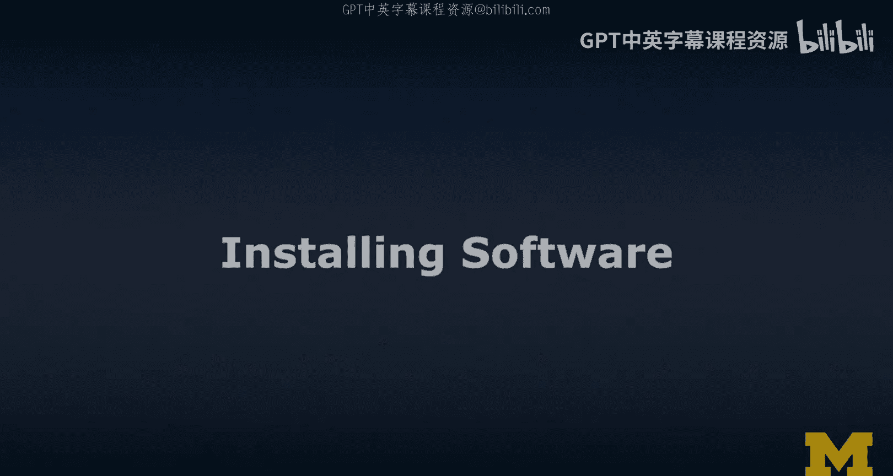
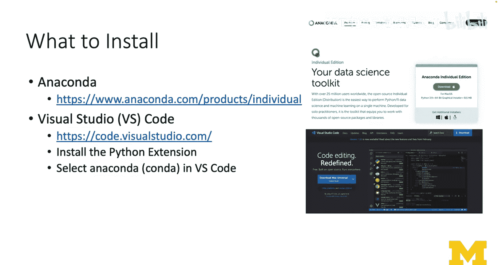
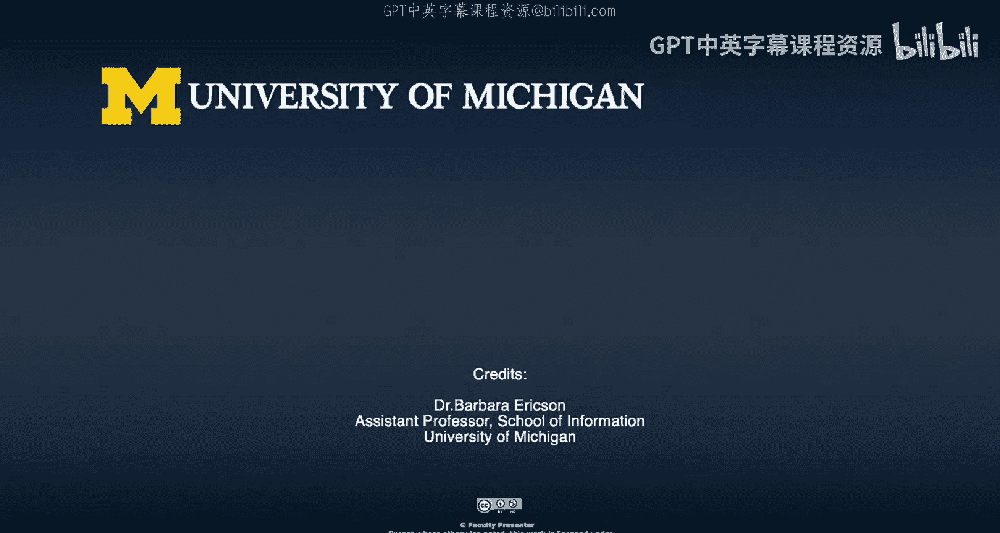

# 密歇根大学《创造性编程（创意、面向对象、debug、QA）｜Creative Coding： Hands-On Python》中英字幕 p96 8_软件安装指南.zh_en -BV1ef421S7Bc_p96-

So in order to run Python on your local computer， we want you to install two things。

 So one of them is Ananaconda。 you can just Google Anaconda， but right now it's at www。anaconda。

 co And when you go there， you can see products individual。 you can download the individual edition。

 And what this does is give you a version of Python。 At this point it's the Python 3。

 but it will change over time。 And but it's Python with other things added that you typically use。

 so that's why we're going have you download that。 And then what you also want is an integrated development environment or an ID and we're going to use visual studio code because it is free and its crossplat works the same on Windows and Mac。

So go to to code。visualstudio。com and again you should see a download button based for your machine。

 download that。Especially important on Windows machines to make sure that you set up you add these things to your past so that it can find things when you're running and then make sure you install the Python extension Once you install visual Studio code and bring it up you'll see this lefthand side that has icons on it and there's little box icons Click on that for extensions and then you could look for Python and install the Python extension and then make sure you select Anaconda or Conda in your VS code at the bottom it should have when you open a Python file it should tell you what version of Python it's using and make sure it says Conda and that's all you need to get started。

