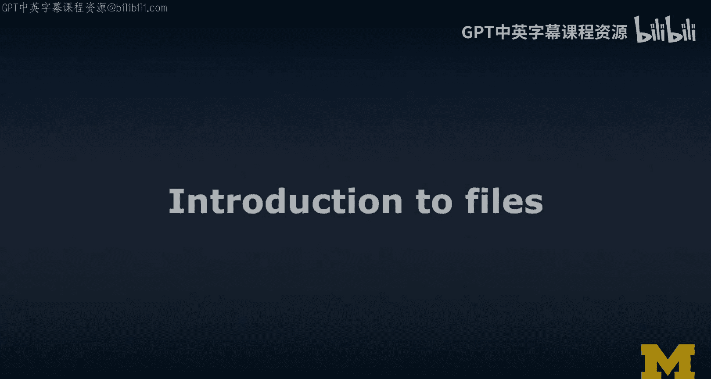
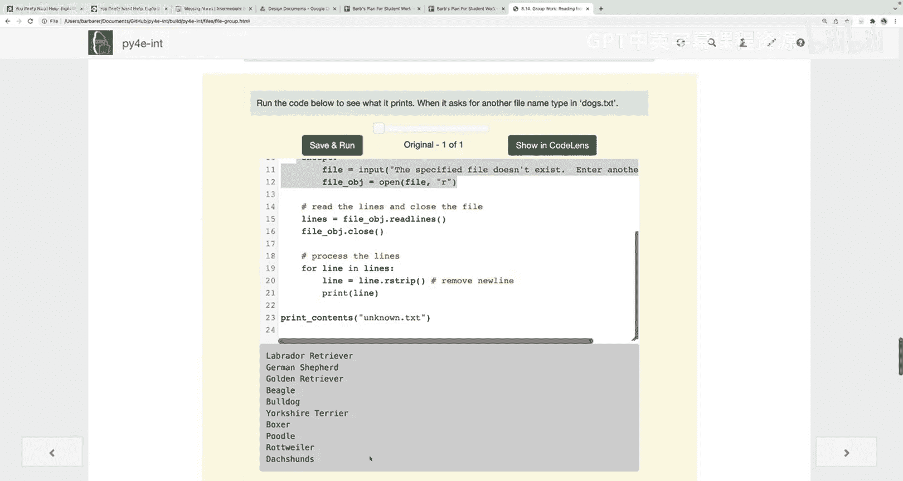
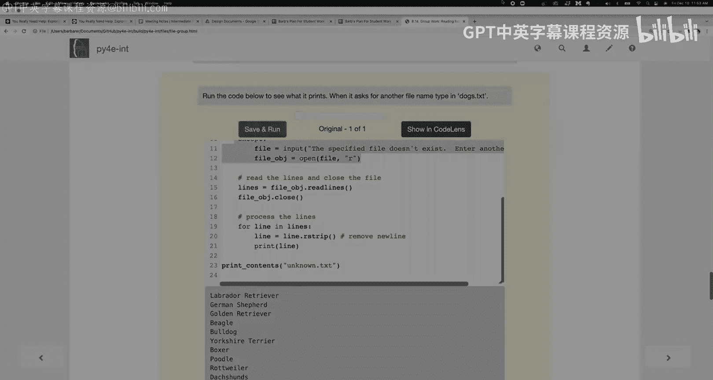

# 密歇根大学《创造性编程（创意、面向对象、debug、QA）｜Creative Coding： Hands-On Python》中英字幕 p97 9_文件操作入门.zh_en -BV1ef421S7Bc_p97-

So what happens if you try to read from a file and it can't find the file where the file doesn't exist。

 So if I run this code， we'll see that we get an I O error， no such file or directory。

 So it could be that the file name isn't found unknown dot T X T or that it's in the wrong directory that it's looking for it。

So if you don't want your code to just crash， how do you solve that？ Well。

 one of the ways is you can enclose any code that could cause an error and exception in a try clause。

 and so I have try colon to show that it's a block indent in the block any code that could cause this problem。

 So here's where I put the file open and I'm opening it for read。

 which courses the default and then you can have an accept clause colon that says here's what to tan to do if that sort of error occurs。

 So if I try to run this code and that file doesn't exist then I get this little pop up that says the file doesn't exist enter another name and I can recover more gracefully from this error by typing in the name and then I can continue。

So using the try and accept is one way that you can protect your code and make sure it doesn't just crash。

 but gracefully handles errors。

