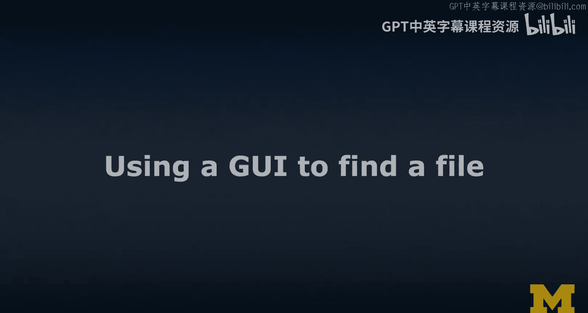
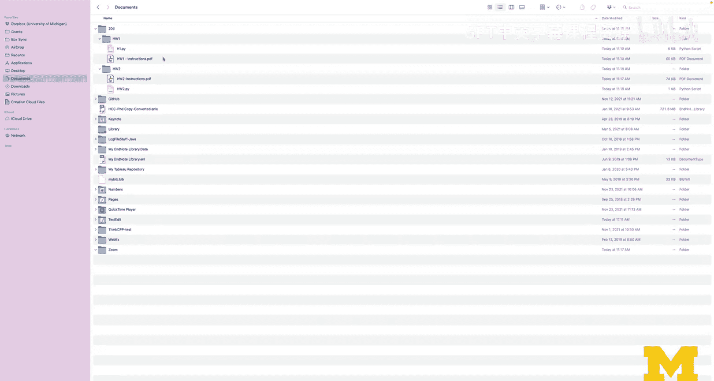
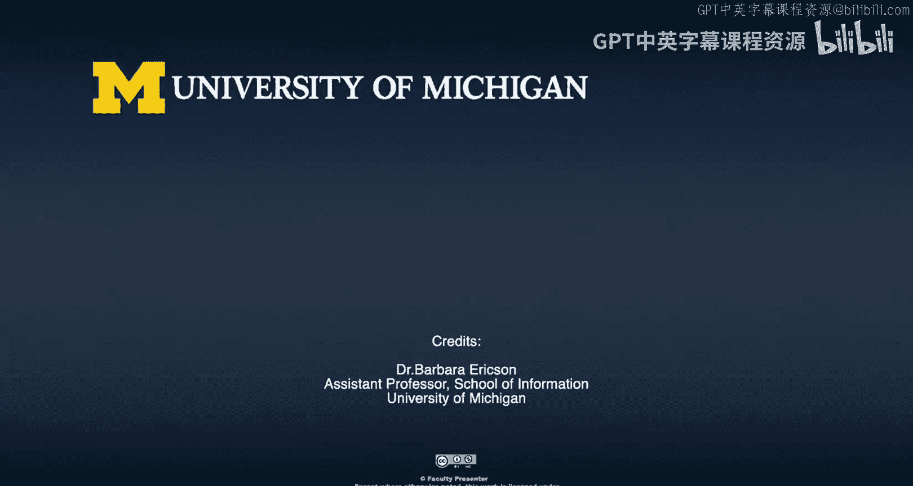

# 密歇根大学《创造性编程（创意、面向对象、debug、QA）｜Creative Coding： Hands-On Python》中英字幕 p98 10_GUI文件查找方法.zh_en -BV1ef421S7Bc_p98-

So you're probably used to using a graph laser interface to navigate on the files and directories on your computer and a directory in a computer is like a tree structure。

 so you have a directory and that has in it files and perhaps other directories that also have files or directories so you think of that as sort of an upside down tree with the root at the top and then the branching at the bottom。

So let's take a look at this so we have here I'm in documents and I see that I have a 206 that's a course that I teach at the University of Michigan if I open that up。

 I see that I have homework1 inside 206 it's another directory and inside that directory there's homework1。

pyy and homework1 instructions there's also homework2 or HW2 open that up I see HW2 instructions and H2。

 Py so you can use the Gly used interface to navigate to a file and then you can typically open it by just double clicking on it but you can also use like the command window before there were graphicly used interfaces we usually operate a computers by typing commands so let me show you that in a moment。

