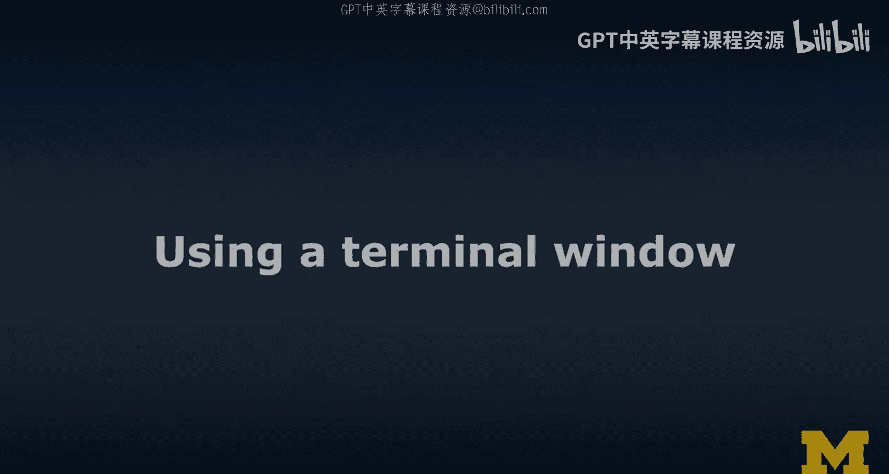
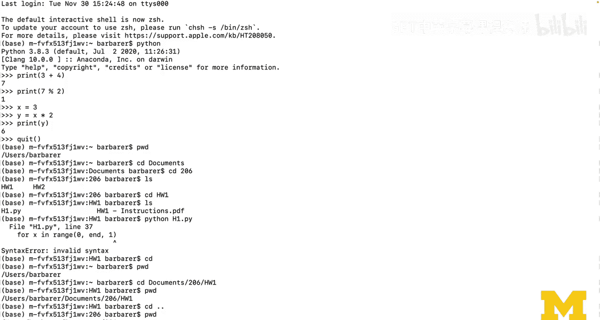
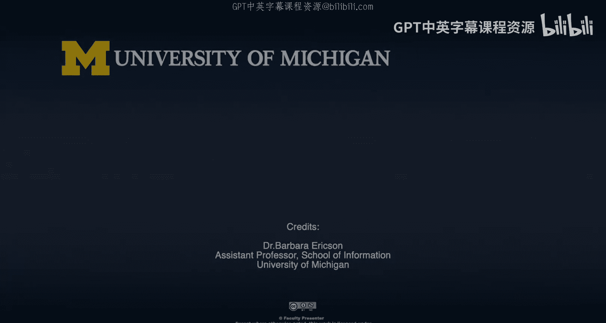

# 密歇根大学《创造性编程（创意、面向对象、debug、QA）｜Creative Coding： Hands-On Python》中英字幕 p99 11_终端窗口使用技巧.zh_en -BV1ef421S7Bc_p99-

Before they wereally user interfaces， we used to type commands at a terminal window and you can still type commands at a terminal window。

 So I'm going to show you a little bit about a terminal window and what's useful for。

 So one of the things that it's useful for is to just go ahead and execute Python once you've installed Python and I can get an interpreter where as I type Python code。

 it'll go ahead and execute it。So what's three plus4， that's  seven， I could say what's7。

 what's the remainder when I divide 7 by 2， that would be one and so you can type things here。

 you could set a variable， you know x equals3 you know and then say Y equals x times 2。

 print y so you can do any things that you can normally do in Python you just do it align at a time。

When you want to quit， you just type quick with parentheses after it and notice that the command prompt is different now right so I can so I can tell I was in the interpreter is because of the triple greater than signs versus just a regular term window it has a dollar sign here。

One thing I can use the terminal 1 to4 is I can navigate。

 I'm in a file structure on a computer and so my home directory here is slashusers/lash Barbara and I can Cd to my documents from there I can CDd to 206 is a course that I teach at the University of Michigan I can then CD I could list the contents of that and see that I have two subdirecties there I could CDd to Hw1 that's for like homework1 in that course I can do LS to list what are the contents of that directory so PwD your printworking directory if you're on a Windows machine。

 you do CHDIR and CD is the same thing for Mac as well as Windows for LS on a Mac will print the contents of that current directory on a Windows machine it would be DIR。

And then。Because I'm here and I have a Python file here。

 I can go ahead and execute this Python file so I can say Python h1。 py and that'll try to run it。

 there's a syntax a that's not going to work。 I can also say CD with nothing after it and just return and that'll take me back to my home directory when I want to change directories if I know several of the directories that's the path to a file the list of directories I can do them one after the other here documents then 206。

 then Hw1 and then I'm back the same place。If I want to go just up one level。

 I can say CD space dot dot on a Mac， just CD dot dot on Windows machine。

 and that'll take me up to one level to the parent directory and I could again go up a level and see where I'm at。

 So that's a little bit about how to use a terminal window。

