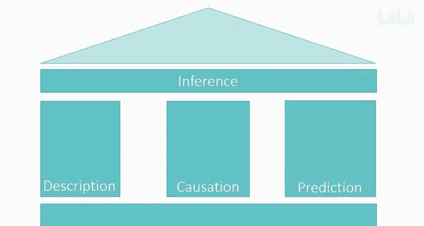
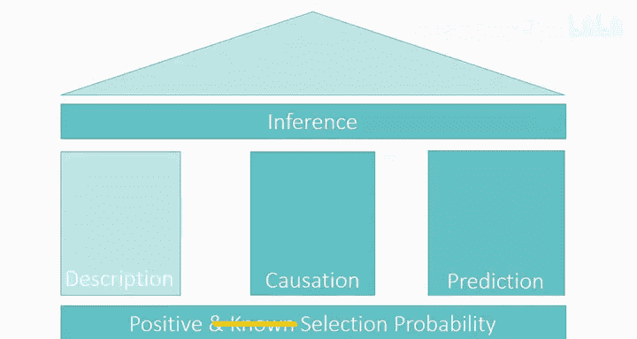

# 1：研究问题设计 🎯

在本课程中，我们将学习数据收集与分析流程的起点：如何设计一个坚实的研究问题。理解研究问题的类型及其对后续数据收集方法的影响，是进行高质量研究的基础。

---

欢迎来到《调查数据收集与分析》课程的第一模块：框架。

在第一模块中，我们将引导您了解整个数据收集与分析的全过程。我们不仅会指出可以使用的不同数据源，还会向您介绍我们专项课程中提供的、针对这些特定步骤进行深入讲解的各个课程。随后，我们将继续介绍一个框架，该框架允许您分别评估每个数据源。

在这些核心课程中，有许多背景不同的学员。例如，有些是研究人员、统计学家、方法论专家，他们可能对调查数据并不了解，但加入了本课程。甚至还有更多领域专家，他们心中有一个特定的研究问题试图解答，并正在寻找如何操作的指导。在问卷设计课程中，我们看到来自世界各地、兴趣迥异的人们，有的关注健康，有的关注劳动力，有的关注交通，可以是任何领域。当然，还有很多市场研究人员。

帮助您获得正确设计和分析的研究，必须与领域专家紧密合作。您的数据集越大，您所拥有的系统与IT基础设施越复杂，与计算机科学家和管理人员合作就越重要。因此，我们希望这门课程是您将学习的众多课程之一，能帮助您稍微了解彼此的语言，更好地沟通您的需求，甚至自己完成所有必要的工作。但最有可能的是，这将是一个拥有各种技能的人们共同参与的项目。

---

上一节我们介绍了课程的整体框架，本节中我们来看看数据收集与分析的具体流程。

这一切都始于一个研究问题。没有一个好的研究问题，您将无法进行好的研究。我无数次看到人们只是拥有大量数据，却不清楚要寻找什么。在下一个模块中，我将特别回到这一点。因为，当您不清楚自己要寻找什么或期望看到什么时，会发生的情况相当令人惊讶。

除了研究问题，数据生成过程也是关键。我花了很多时间讨论数据生成过程。理解数据生成过程的重要性至关重要。事实上，我敢断言，如果不正确了解这个过程，您就无法进行任何推断。

然后，这里需要进行大量的数据清理、数据创建和数据存储工作。IT基础设施和系统管理人员可以为您提供很大帮助。本课程不涉及编程，我会向您展示一小段对此重要的内容，但大体上，其他课程（例如约翰霍普金斯大学的数据科学专项课程）有专门针对这类内容的完整课程。我们在这里的关注点更偏向概念性：规划一个好的研究，知道是使用现有数据源还是设计并收集新数据。

当然，还有数据分析部分。你们中的一些人可能很久以前上过统计学入门课程，记得自己不喜欢它们，或者很喜欢但觉得它们太理论化，不像您在这里需要的那么实用，或者它们使用了非常不同的数据。在本专项课程中，我们有一个部分专门处理数据分析，特别是针对调查数据，因为您经常会遇到抽样、加权以及具有层次结构的复杂性质等问题，这确实需要不同类型的分析。那门课程将涵盖这些内容，我会提到它，您也可以在课程平台上看到关于这部分的具体信息。

最后，是数据输出和访问。在本课程中，我们将稍微讨论涉及的伦理问题，并在后续的一些其他课程中再次回到这个话题。

---

我已经对这个流程谈了很多，但为什么还要更详细地讨论每个步骤呢？让我们看看。

如果我们思考一个研究问题，可以轻松地将其分为三个不同的类别。

以下是研究问题的三种主要类型：

1.  **描述性研究问题**：我们试图展示某些子组的均值、百分比等。例如，图中三个组（虽然没有坐标轴，我们不知道具体是什么）。这只是描述性统计的图像，您试图输出一些关于世界、关于世界某一部分的数字，描述某些变量或特征在世界上出现的情况。
2.  **因果性研究问题**：这类问题涉及因果关系。例如，想知道某种处理（如服用止痛药）是否有助于缓解头痛并让人微笑。我们可以就这个问题开设一整门课程，因为问题在于我们是否真的能测量因果关系。对于人类来说，通常很难（如果不是不可能）看到反事实——如果我没吃那颗药会发生什么？这几乎不可能做到，实际上就是不可能。总有一些因素在变化。然而，不仅在医学领域，在经济学和公共卫生领域也越来越多，这是一个重要的研究问题，并且有针对此收集的数据和实验。
3.  **预测性研究问题**：您在这里看到的是一张来自美国能源信息署的图表，他们发布了漂亮的图表，我建议访问他们的网站。您看到了对美国油价的预测。我想说的是，无论您处理的是描述、因果还是预测，您很可能心中都有某种推断的目标。

---

上一节我们区分了研究问题的类型，本节中我们来探讨这些类型共有的一个核心概念：推断。

这是什么意思呢？推断意味着存在一个更大的总体、更长的时间框架或更大的地理区域，您希望您的结果在其中成立。例如，当我想描述美国人口时，比如说我想给出美国不同子群的百分比描述，那么我当然必须定义我所说的“美国人口”是什么意思。而且很可能，我无法获得美国每个人的这类数据，部分原因是人们时刻在出生和死亡。因此，我只能拥有某个特定时间点的片段。即使我能够进行人口普查，您只需浏览人口普查网页就会发现进行人口普查本身有多困难。

因此，更多时候，人们采用调查，或者更准确地说，抽样调查。即从一个更大的总体中获取一个较小的数据集，在这种情况下，您希望推断到更大的总体。对于因果关系和预测，情况可能也是如此。它们都依赖于某种形式的数据，而这些数据很可能是样本数据，无论是在地理空间上、时间上，还是因为它们是总体的一个子集。即使您可以访问所有推特数据，您也可能无法用所有数据进行分析，因为数据在不断涌入。现在计算和软件速度越来越快，您可以更新分析，但处理能力总是有限制，您可能需要时不时查看结果。

因此，无论是以时间、空间还是人数为形式，您最终都会进行某种推断。现在，对于数据子集、抽样或选择观察哪些个案、哪些单位的要求，根据我们处理的是描述、因果还是预测，会略有不同。

对于描述，我认为您需要的是**正向且已知的选择概率**。为了真正能够说“25%的人口对某事感兴趣”，我需要知道：a) 总体是什么；b) 我还要确保该总体中的每个人（无论我如何定义）都有一个正向的选择概率。如果我通过收集数据的方式系统地排除了总体中的某些部分，使他们无法向我报告他们的兴趣（或者，如果我对美国人的平均血压感兴趣，报告他们的血压），那么我就有结果偏差的风险，我的结果无法正确推断到整个总体。我还应该知道选择概率，因为如果我只取一部分，特别是如果我想估计总数，我需要加权数据，使其与总体中的值一致。所以对于这个特定部分，正向且已知的选择概率——能够知道每个人都有机会提供数据，并且我知道该概率是多少——非常重要。您将在抽样课程以及关于缺失数据的课程中学习如何处理这些知识，因为显然在实践中，情况永远不会如此理想，总有一些个案因某种原因缺失，有技术可以克服这个问题。

对于另外两种类型（因果和预测），已知的选择概率就不那么重要了，可能根本不重要。然而，我确实想知道，我仍然对每个人都有正向的选择概率。只有这样，我才会放心进行那种推断。

现在，让我们暂时离开对人的讨论。您可以换一种方式思考。如果我们考虑推特数据和在推特上表达的情绪，如果我想对所有可能的情绪进行推断，那么您必须问自己：我使用的数据库、主体、语料库是否对所有可能的情绪都有正向的选择概率？如果是，那么即使人和情绪不是一一对应，我也可以进行推断。这对于工作、疾病等任何类似情况都可能成立。因此，重要的是您要知道您观察的单位是什么，以及您想推断到的总体中包含哪些单位。然后，当您谈论您的数据时，您应该讨论这些方面，否则人们可能会被您提供的数据误导。

---

本节课中我们一起学习了研究问题设计的基础。我们明确了研究流程始于一个清晰的研究问题，并将其分为描述性、因果性和预测性三类。更重要的是，我们认识到无论哪种类型的研究，通常都涉及从样本到总体的**推断**过程。对于描述性研究，确保**正向且已知的选择概率**对于获得无偏估计至关重要。理解这些核心概念，是规划后续数据收集与分析方法的第一步。在接下来的课程中，我们将深入探讨如何根据不同的研究目标选择合适的数据源。