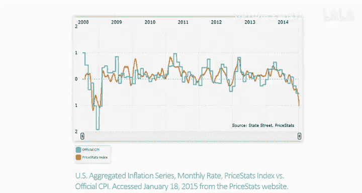
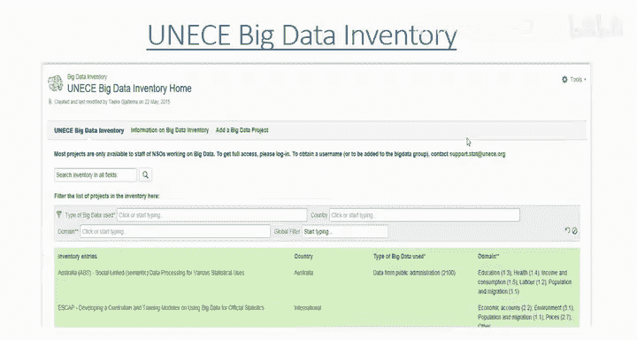
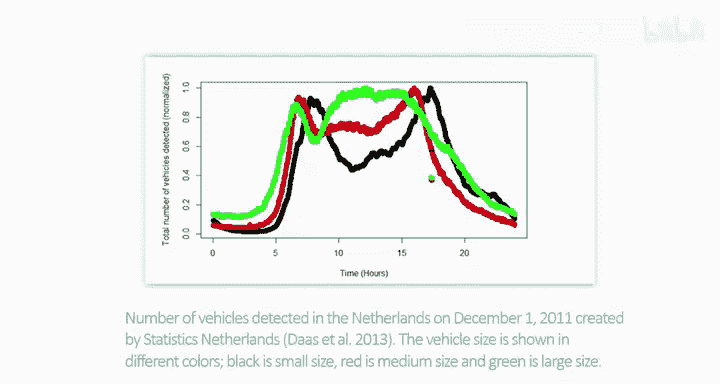
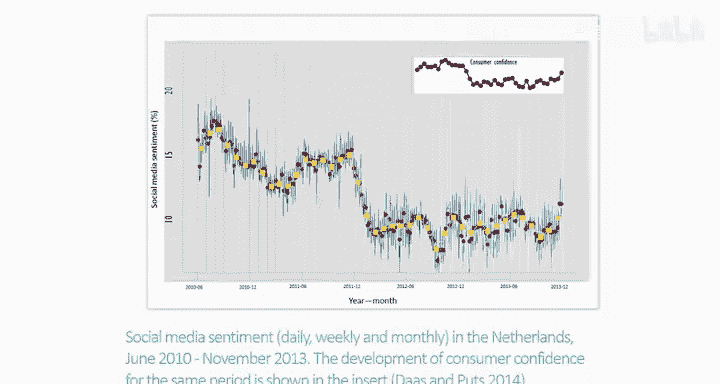

# 3：发现数据实例 📊

在本节课中，我们将学习“发现数据”这一概念。我们将了解政府机构、大型组织如何利用那些并非为特定研究目的而主动收集，但已存在于其他流程中的数据，并探讨使用这类数据时面临的挑战。

上一节我们介绍了数据收集的整体框架，本节中我们来看看“发现数据”的具体实例与应用。

现在，政府项目，更准确地说，联邦统计系统，以及像欧盟统计局或联合国欧洲经济委员会这样的大型实体，正在探索这些替代性数据源。这些数据是某个流程的一部分，对其感兴趣的分析者并非数据的发起者，但仍希望利用它们进行分析。

例如，目前普遍存在的一个做法是尝试通过捕获价格统计信息来创建消费者价格指数。具体来说，就是从网络上抓取特定商品的价格数据，并对其进行长期跟踪。

有一个非常有趣的网站值得你关注，即麻省理工学院的“十亿价格项目”。他们正尝试将该项目的数据与美国消费者价格指数进行匹配。

移动电话数据是当今许多国家关注的另一个数据源，并试图从中获取信息。许多城市采用智能媒体或交通环路中的传感器，或者利用社交媒体数据来捕捉公众情绪，而不是反复进行问卷调查。

但请记住，因为这些数据是被“发现”的，有时甚至更难使它们与你的研究问题相匹配。并且，你无法控制数据的生成过程。因此，为了做出有效的推断，你可能需要对数据生成过程的每一步有更多、更深入的了解。

这就是为什么在本模块中，在我们为你提供整体框架的同时，会大量讨论质量要素。如果你想查看那个大数据清单，可以随时浏览该网站。

链接可在我们的课程页面找到。以下是我刚才提到的消费者价格指数的一个例子。

这是一个来自荷兰交通环路的例子，以及与之相应的参考文献，你可以从我们的网站访问。

同样来自荷兰，还有将社交媒体情绪与荷兰消费者情绪会计调查相匹配的例子。

本节课中我们一起学习了“发现数据”的多种实例，包括网络抓取价格数据、移动电话数据、传感器数据和社交媒体数据。我们认识到，虽然这些数据源提供了新的可能性，但由于研究者不控制其生成过程，要将其有效用于研究并做出有效推断，需要格外关注数据质量与生成过程的了解。