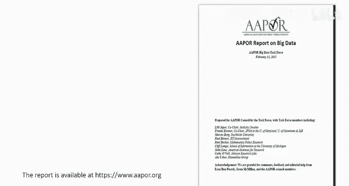

# 📊 密歇根大学《调查数据收集和分析（第1课：框架）》 - P4：数据生成过程可视化

在本节课中，我们将学习如何可视化数据生成过程。理解数据是如何产生的，对于后续进行有效的数据分析和推断至关重要。

## 概述

数据生成过程描述了数据从概念到最终被记录和分析的完整流程。无论数据是“被发现”的还是“被设计”的，我们都必须思考这一过程，以识别可能影响分析有效性的各种因素。

## 数据生成过程的核心问题

在审视任何数据集时，我们都应该问自己以下几个关键问题：
*   **谁**参与了数据生成？
*   **测量**了什么内容？
*   数据是**为何**被生成的？
*   数据中**缺失**了什么？
*   数据**不包含**什么？

思考这些问题有助于我们识别所有可能妨碍我们做出有效推断的潜在因素。

## 调查数据的生成过程可视化

上一节我们提出了审视数据生成过程的核心问题，本节中我们来看看一个具体的可视化框架。

对于调查数据，一个经典的可视化模型来自罗伯特·格罗夫及其同事的教科书。该模型清晰地展示了数据生成的两个主要方面：

如图所示，该图分为两个主要部分：
*   **左侧（测量过程）**：描述了如何将一个抽象的研究**构念**，通过设计具体的**测量**问题，最终转化为受访者提供的**回答**，并可能经过后续的编辑处理。
*   **右侧（代表过程）**：描述了如何从目标**总体**中，通过**抽样框**抽取一个**样本**，并最终获得**受访者**的数据，可能还需要进行事后调整。

理解这两个过程对于得出良好的调查统计结果都必不可少。本课程的模块2和模块3将对图中的每个环节进行详细讲解。

## 其他数据类型的生成过程

当然，类似的生成过程可视化思路也适用于其他类型的数据。

正如调查数据有其生成模型，对于其他数据源，我们也可以构建类似的图表。例如，保罗·比亚姆在AAPOR大数据工作组报告中提出了一个针对大数据（如网络数据）的生成过程模型。

该模型通常包含以下环节：
1.  从网络等多种来源**提取**原始数据。
2.  对数据进行**编辑**和处理。
3.  生成并存储**变量**或**特征**。
4.  在分析时，可能需要进行数据**约简**以便快速计算。
5.  最终进行计算和**可视化**。

分析数据时，了解这个流程以及其中每一步发生了什么同样重要。

## 过程数据：元数据的重要性

一个有趣的现象是，收集调查数据的过程本身也会产生数据，我们称之为**过程数据**或**元数据**。

以下是元数据的一些例子：
*   访问员将受访者信息录入电脑的**时间戳**。
*   访问员外出进行访问时的**天气信息**（可能影响受访者的情绪和回答）。
*   访问过程中的**语音特征**（如访问员说“嗯”、“啊”的次数，这可能影响受访者的参与意愿）。

这些元数据本身也是数据生成过程的一部分，会影响最终的数据质量。我们将在后续关于问卷设计以及面对面、电话和网络调查数据收集的课程中讨论这些内容。

## 总结

本节课中，我们一起学习了数据生成过程的可视化方法。我们了解到，无论是调查数据还是其他数据（如行政数据、实验数据或网络大数据），理解其从产生到被分析的完整链条都至关重要。通过可视化这一过程，并思考“谁、什么、为什么、缺失什么”等核心问题，我们可以更好地评估数据质量，识别潜在偏差，从而为做出有效的统计推断奠定坚实基础。

---

*（上图展示了AAPOR大数据工作组报告中的相关图示，建议结合报告原文以获得更详细的解释。）*