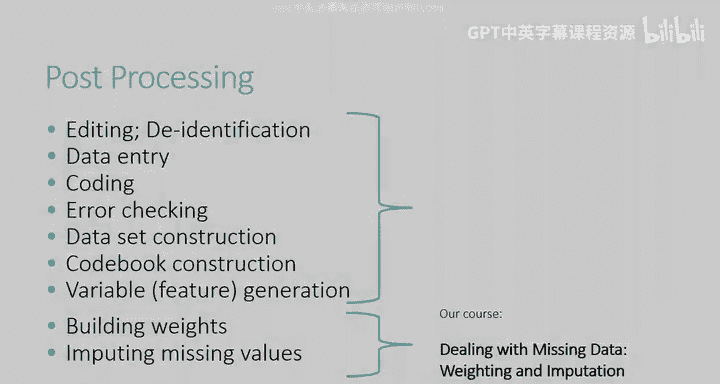

# 5：数据治理 📊

在本节课中，我们将要学习数据治理的核心概念，特别是数据创建后的处理步骤。我们将探讨数据如何从原始状态转变为可供分析的结构化形式，并介绍在此过程中涉及的关键变量类型。

---

## 数据创建与编辑

上一节我们介绍了数据收集的框架，本节中我们来看看数据被创建后的初步处理步骤。

数据创建后，通常不会直接进入分析阶段。就像一张校园风景照片，我们可以通过编辑改变其颜色或风格。处理调查数据时也是如此，编辑是数据创建步骤中不可或缺的一环。

在大数据处理流程中，我们通常不会保留所有流入的原始信息。编辑可能涉及剔除某些元素、限制特定类型的记录，或根据地理编码进行筛选。这个步骤也常被称为**数据整理**。

## 数据后处理步骤

编辑并非数据收集后唯一的处理步骤。在数据实际被收集之后，通常还会进行一系列后处理操作。

以下是数据后处理中常见的步骤：

*   **去标识化**：确保个人可识别信息不再存在于数据集中。
*   **数据录入**：将纸质记录或录音等非数字化信息录入系统，转化为数据点或数值。
*   **编码**：对开放式问题的答案进行分类，这个过程可以自动化，例如使用机器学习技术。
*   **错误与一致性检查**：检查答案中的错误或矛盾之处，例如购买时间不可能早于商品选择时间。
*   **数据整合**：由于收集的数据可能处于不同层级（如家庭层面和个人层面），通常需要构建一个全新的数据集，将这些信息拼合在一起。

这个前端处理过程，包括编码和变量构建，在Coursera的其他课程中有详细涵盖。我们会简要讨论，但本课程的重点将放在其他方面。

## 变量类型

在深入分析之前，理解数据的基本构成单元——变量——至关重要。我们主要区分两种变量类型：连续变量和分类变量。

**连续变量**的例子是血压。它几乎可以在任何范围内取值，属于区间尺度或比率尺度。比率尺度通常专指那些具有明确零值的变量，并非所有区间尺度变量都满足此条件。

**分类变量**则分为有序分类变量和名义分类变量。前者类别间存在顺序，后者类别仅彼此不同，没有顺序。

例如，一个问题“你是否拥有汽车？”的答案类别“是”和“否”，就是一个**名义分类变量**。在“是”和“否”之间没有排名顺序。

## 从问题到变量/特征

关于如何设计一个好的问题，你将在问卷设计课程中学到。但在数据处理的任何环节，都必须确保当问题被转化为变量（或计算机科学中常说的**特征**）时，处理得当。

对于具有多个选项的分类问题，你需要为每个选项创建一个变量，以表示“适用”或“不适用”。因此，即使最初看起来是一个问题，最终在你的数据集中，可能会生成多个不同的变量或特征。

例如，一个关于“拥有何种类型汽车（可多选）：公共、私人、共享……”的问题，之后在数据集中可能会变成“公共：是/否”、“私人：是/否”等七个不同的变量。

## 本专项的重点

本专项后续课程的重点将放在**构建权重**和**插补缺失数据**上。即，当数据集中缺少某些信息时，应如何处理。

因为在这之间的数据处理步骤，许多人最终会在实践中学习，或者正如之前提到的，幸运的是在Coursera上也有其他课程专门教授这些内容。我们将更进一步，确保你能全面掌握整个数据集，从而进行正确的数据分析。

---

本节课中我们一起学习了数据治理的基本流程，包括数据创建后的编辑、一系列后处理步骤（如去标识化、编码），以及数据分析中两种核心的变量类型：连续变量和分类变量。理解这些基础概念是确保后续数据加权和缺失值处理工作有效进行的前提。