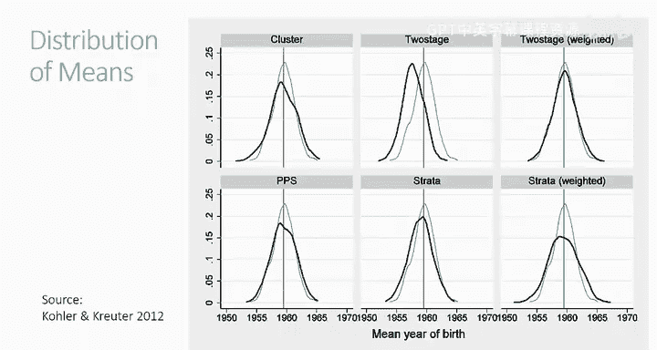
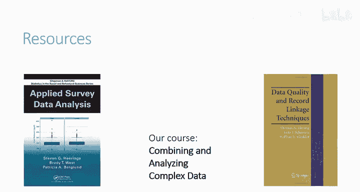

# 6：数据分析概述 📊

在本节课中，我们将要学习数据分析课程的核心内容与挑战。我们会探讨标准分析流程中可能遇到的问题，并理解为何正确捕捉数据变异性至关重要。

---

显然，一门关于数据分析的课程可以涵盖许多不同的主题。

我们会学习均值、百分比、总和的计算方法。

我们还会学习如何估计均值间的差异、如何进行回归分析、如何使用聚类技术。

许多统计学课程会涵盖这些内容，有些在基础统计学中教授，有些则在高级课程中涉及。

其中一部分，你的软件包知道如何操作，并能为你提供良好的指导来完成它。

然而，在许多数据情境中，这些标准流程都伴随着挑战。

你需要了解这些挑战，并知道如何处理。其中一个例子是：

当你开始链接不同的数据源时，这些数据可能处于不同的层级。

这使得分析变得更加复杂和困难。

你会希望将这些因素考虑在内，但更重要的是，你需要正确地捕捉变异性。

为了提供一个百分比、均值或总和的估计值，甚至是为了讨论处理效应的大小或预测的精确度，在所有这些情况下，因为你是在进行推断——从手头的数据推断到更广泛的人群、时间或空间——你需要确保你传达估计值或统计量变异性的方式是**正确**的。

假设我们抽取一个包含三个小头像的样本。

在一个样本中，可能全部是蓝色。下一个样本中，可能每种颜色各有一个。

显然，每个子样本都可能不同，而这就是你希望在分析中正确捕捉的那种变异性。这正是我们分析课程的核心内容。

如果你上过之前的测验，你可能还记得置信区间、标准误差这些概念。可能只是模糊记得。

这里有一个可视化示例，展示了从德国社会经济面板数据集中抽取的100个样本。

这里显示的是该人口（在此案例中指GSOEP数据集）的平均出生年份。

你看到的带状区域，即围绕中点的细条纹（看起来像一条领带），在中间是那个特定样本的估计值，就像我之前那个全是蓝色头像的样本一样。

所以，这里是那个特定样本的估计值，周围是一个区间带。目前我们暂不关心如何具体估计这个区间带，那是后续分析课程会教你的内容。

但你可以看到，大多数时候，这个误差区间是以一种方式构建的，使得它大多数时候确实包含了中间的真实均值，有时像这里这些空白样本一样没有包含。

这取决于你如何构建它们。这会影响到，在你假设可以重复抽取的样本中，有多少会或不会捕捉到真实的总体均值。这就是与抽样相关的变异性问题。

现在，当你从整个总体中抽取一些样本，或者从特定时间点、特定部分总体中，以我们称之为简单随机抽样、按地理分组抽样或其他形式获取数据时，了解抽样这一环节非常重要。

因为当你绘制图表时，正如你在这里看到的每个样本的均值，并将它们全部堆叠起来，你会看到这些不同样本均值的分布情况。

根据你采用的抽样技术，这个分布可能比总体分布更宽或更窄。

它也可能存在偏差，即分布中心偏离真实中心。

我知道你们中有些人可能不了解这些术语，这没关系，因为我们确实也希望你们学习抽样课程。

这只是一个引子，说明学习抽样是值得的。根据你使用的技术，你的变异性可能会改变，但无论你做什么，在发布结果时都必须反映这种变异性，而这正是这些后续课程要讲的内容。

资源方面，正如我所说，**合并与分析复杂数据**是一门课程。

**抽样课程**本身是另一门。

特别是左边这本优秀的书籍，由我们在密歇根的三位同事——Diering, Pe Bdlin 和 Brady West——合著的《应用调查数据分析》，强烈推荐。

---

本节课中，我们一起学习了数据分析课程的主要范畴及其核心挑战。我们明确了正确估计和传达数据变异性的重要性，它是从样本推断总体的基础。我们还预览了抽样设计如何影响分析结果的分布与偏差，并介绍了后续的相关课程与学习资源。理解这些概念是进行严谨数据分析的第一步。