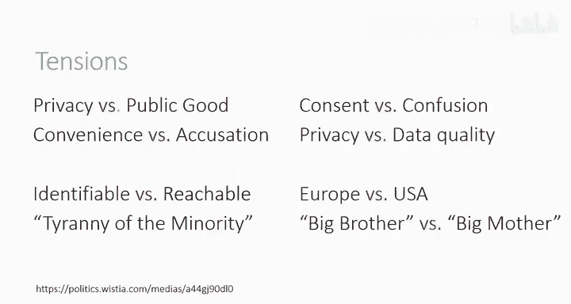

# 密歇根大学《调查数据收集和分析》第1课：框架 - P7：数据获取问题 🧩

在本节课中，我们将探讨数据获取环节的核心问题，特别是围绕数据可访问性、隐私保护以及两者之间存在的诸多矛盾。理解这些问题是进行负责任的数据分析的基础。

上一节我们介绍了数据收集的流程，本节中我们来看看数据获取环节所面临的挑战。

## 数据可访问性与隐私的张力 🤔

当前，海量数据的可访问性是我们作为数据分析师、数据科学家或统计学家感到兴奋的原因。大量数据公开可用，并可用于公共利益。

然而，这其中当然存在隐私问题，以及我们尚未解决的挑战性难题。在相关文献中，你会发现许多章节都在处理这种张力：一方面是个体隐私，另一方面是可能创造的公共利益。

以下是几组核心的矛盾关系：

**隐私与公共利益的矛盾**
例如，谷歌提醒我该何时出门才能准时上班，这带来了便利。但另一方面，私营公司了解我的一切，这些数据日后可能被用于指控、或拒绝提供某些产品或服务（尤其是在保险和贷款领域），这是一个激烈争论的话题。

**可识别性与覆盖范围的矛盾**
存在一种张力：即使我决定不向Facebook等平台提供我的数据，但其他使用Facebook的人（可能已非少数）可能会报告关于我的信息，因此隐私同样无法得到保证。

**知情同意与复杂声明的矛盾**
这涉及征询人们是否愿意并有目的地提供数据的知情同意，与许多此类同意声明实际上非常令人困惑的事实之间的矛盾。例如，有多少人在使用智能手机或其他收集数据的电子设备时，真正阅读并理解了所有隐私声明？

**隐私与数据质量的矛盾**
例如，当人们知道这些数据将被收集时，可能会开始误报年龄或其他信息，这影响了数据质量。

**文化背景与隐私观念的矛盾**
你所谈论的国家背景至关重要。不同文化背景下，人们对隐私的看法差异很大。例如，德国人非常担忧“老大哥”式的监控，而其他国家的人可能更愿意为公共利益贡献数据。

---

本节课中我们一起学习了数据获取过程中的核心矛盾，包括隐私与公共利益的平衡、知情同意的实践难题，以及数据质量与文化背景的影响。理解这些张力是进行合乎伦理且有效的数据分析的第一步。