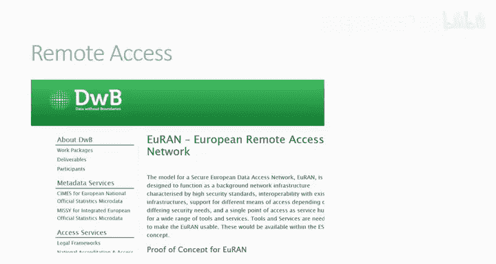

# 密歇根大学《调查数据收集和分析》第1课：框架 - P8：获取资源 📚

在本节课中，我们将学习如何寻找和获取用于研究的调查数据、实验数据以及行政数据。了解这些资源的存放位置和访问方式，是进行数据分析的重要第一步。

## 数据资源的类型与存放地

上一节我们讨论了记录连接和数据分析，现在我们来具体看看数据从哪里来。研究人员收集的许多数据，尤其是调查数据，都是经过**去标识化**处理的。去标识化技术（例如**数据脱敏**或**匿名化**）在数据共享前用于保护受访者隐私。

这些处理后的调查数据或实验数据通常会被存入数据档案馆。以下是一些知名的数据档案馆示例：

*   **英国数据档案馆**：非常值得访问，并且越来越多地收录行政数据。
*   **美国ICPSR**：社会科学领域一个非常庞大且流行的数据档案馆，已存在多年。
*   **德国相关档案馆**：德国也有类似的机构。

以上例子带有我的地域偏好。我相信你们可以根据自己所在的国家，找出类似的数据集或档案馆，并与学习本课程的同学分享。

## 政府与机构的开放数据

一个有趣的现象是，越来越多的联邦机构、国家统计研究所，甚至是像德国联邦就业局这样的组织，开始将他们作为行政流程一部分所收集的数据，提供给本国乃至全世界的研究人员使用。

我目前的雇主之一，德国就业研究所，就建立了研究数据中心。这些中心允许研究人员远程访问其存储的数据（显然是完全去标识化的，或对访问者和访问方式有严格限制），但这已成为可能，为你们的分析工作提供了丰富的资源。我强烈建议访问这些网站。

## 重要的数据门户网站

以下是几个重要的数据获取门户：

*   **Data.gov**：如果你还没访问过这个网站，一定要去看看。我意识到并非所有国家都能访问.gov网站，对此我表示歉意，并希望情况能有所改变。
*   **欧洲统计局**：同样发布大量数据，虽然可能没有那么多可供重新分析的微观数据，但肯定有可以下载的汇总表格和图表。

这些网站上的资料数量一直在更新。这类网站的一个优点是，它们经常将数据与**方法报告**配对提供，这能让你充分了解我们之前讨论过的**数据生成过程**。

## 开放数据运动

总的来说，目前存在一场强大的**开放数据**运动，包括开放数据论坛和开放数据访问。许多国家越来越认同这一理念，因为运行某些机构、制定政策决策的人员，没有足够的人手来分析所有数据，他们依赖你们来利用这些数据，从中获得深刻的见解。

“**Data without Boundaries**”是一个有趣的倡议，它试图至少在欧洲乃至更广范围内，使数据的访问和交换变得更加容易。

## 总结

本节课我们一起学习了研究数据的获取途径。我们了解到，去标识化后的数据通常存放在专业的数据档案馆中，例如英国的UK Data Archive和美国的ICPSR。同时，各国政府与统计机构也正积极参与开放数据运动，通过门户网站如Data.gov提供数据资源。这些资源常附有详细的方法报告，有助于我们理解数据背景。充分利用这些开放数据，是进行研究分析的重要基础。