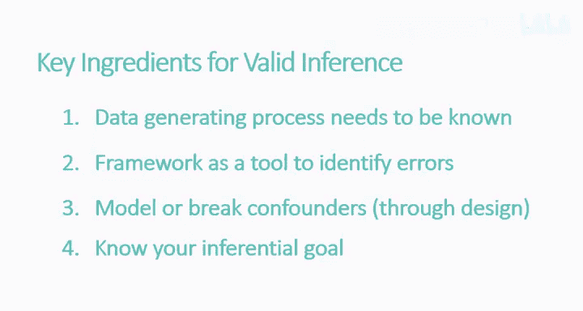

#  9：总结 🧱

在本节课中，我们将回顾并总结关于“有效推断”的核心框架与关键要素。

上一节我们介绍了有效推断的总体思路，本节中我们来总结其核心要点。

以下是构成有效推断的关键要素：

*   **明确数据生成过程**：必须确保**数据生成过程**是已知的。这意味着你需要理解数据是如何被收集和产生的。
*   **建立分析框架**：必须在心中建立一个**分析框架**。这个框架能帮助你系统地识别可能出现的各类误差。
*   **清晰界定研究目标**：必须明确你的**研究目标**。这包括知道你的研究问题是什么，你试图对谁做出何种推断，以及推断结果应对谁有效。

接下来的两个模块将在此基础上展开。有时，当存在**混淆变量**或其他干扰因素妨碍你做出有效推断时，可以使用统计技术来帮助克服这些问题。

然而，为了知道你需要克服什么问题，你首先必须清楚自己的目标。这意味着你需要明确研究问题以及试图做出的推断类型。

本节课中我们一起学习了有效推断的基本框架，其核心在于理解数据来源、建立分析模型并明确研究目标。沿着这个思路，我们将在下一个模块中进行更深入的探讨。